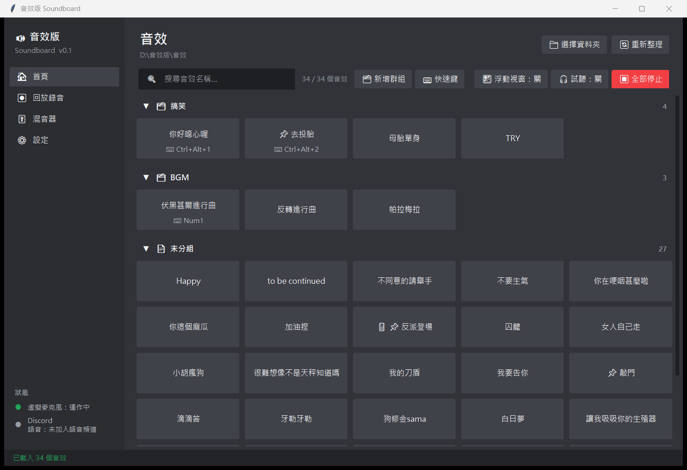

# 🔊 Soundboard (音效版)

**English** | [繁體中文](README.zh-TW.md)

A Windows desktop soundboard that lets **users without Discord Nitro** play sounds and send stickers in voice calls.
It also works in game voice chat and any other program that lets you choose a microphone.



## Features

| Feature | Description |
|---|---|
| 🔊 **Soundboard** | Put sound files in a folder and they become buttons. One click plays the sound to the people in your call, with no length limit. Supports groups, search, Preview (only you can hear it), and per-sound volume and trimming |
| ⌨ **Global hotkeys and floating window** | Without leaving your game, play sounds with hotkeys, or open a small semi-transparent soundboard in a corner of the screen |
| ⏺ **Instant replay** | Continuously keeps the last few minutes of audio (your microphone, Discord, YouTube, and so on). Click once to capture it, then trim it into a new sound |
| 🎚 **Mixer** | Send audio from programs such as Spotify and Chrome to the people in your call, with all volumes adjusted on one page |
| 🚪 **Join sound** | Automatically plays a chosen sound when you join a Discord voice channel (a feature that normally requires Nitro) |
| 🔇 **Microphone noise suppression** | Uses RNNoise to filter out keyboard and fan noise. It processes only the microphone and does not affect sounds |
| 🖼 **Stickers** | Click a sticker to copy it, then press `Ctrl+V` in Discord to send it. Animated stickers are converted to GIF automatically. Matching stickers appear as you type (keyword search), LINE message stickers can use text you enter, and a webhook can send them directly to a channel |
| 🖥 **Background operation** | Starts with Windows and stays in the system tray. Hotkeys and join sounds keep working after the window is closed |
| 🌐 **Multilingual** | 繁體中文, English, 日本語, 한국어 |

## How It Works

The soundboard mixes your sounds with your microphone and sends the result to a "virtual microphone" (VB-CABLE), which Discord then uses as its microphone:

```
Sounds, app audio ────────────┬──> Headphones (you hear it)
                              │
Microphone (noise suppressed)─┴──> Virtual microphone ──> Discord's input device
```

## Quick Start

1. Install the free virtual audio cable [VB-CABLE](https://vb-audio.com/Cable/), then restart your computer (one time only).
2. Download `Soundboard-*-win64.zip` from [Releases](https://github.com/Hou-Bo-Wei/Soundboard/releases/latest), extract it, run `Soundboard.exe`, and put your sound files in the adjacent "音效" folder.
3. In Discord, go to "Voice & Video": set **Input Device** to `CABLE Output`, and **turn off Noise Suppression and "Automatically determine input sensitivity"** (otherwise your sounds will be filtered out; use the soundboard's built-in noise suppression instead).

To run from source (Windows 10/11, Python 3.10 or later):

```powershell
pip install -e .
```

```powershell
python -m soundboard
```

## Companion Tools

| Tool | Description |
|---|---|
| [LINE sticker downloader](tools/line_sticker_dl) | Paste a LINE Store URL to save an entire sticker set (including animated stickers) as transparent-background images, ready to use on the Stickers page. If you enter a Claude API key, search keywords are generated automatically after the download |
| [Sticker keyword tool](tools/sticker_keywords) | Generates keywords for an already-downloaded sticker folder: builds an overview image, imports keywords, and checks progress |

> Sticker copyrights belong to their original authors. Please use them for personal purposes only.

## Architecture

Python and Tkinter, with the source code in a `src/` layout:

```
src/soundboard/
├─ gui/             UI: Home, Stickers, Instant replay, Mixer, Settings, and other pages
├─ engine.py        Audio engine: three streams (headphone monitoring, virtual microphone, physical microphone)
├─ mixer.py         Real-time mixing, volume, and limiting
├─ denoise.py       Microphone noise suppression (RNNoise)
├─ replay.py        Instant replay (multi-source ring buffer)
├─ app_audio.py     Mixer: captures audio from specific programs (WASAPI process loopback)
├─ stickers.py      Sticker scanning and conversion (animated to GIF)
├─ sticker_meta.py  Sticker keywords and match ranking
├─ hotkeys.py       Global hotkeys    overlay.py  Floating window    tray.py  System tray
└─ locales/         Translation files
tools/              LINE sticker downloader, sticker keyword tool
packaging/          Build the exe, sync translation files
tests/              Unit tests
```

Common development commands:

```powershell
python -m pytest
```

```powershell
python packaging/build_exe.py
```

## Detailed Guide

For how to use each feature, its settings, and frequently asked questions, see the **[detailed user guide](docs/GUIDE.md)**.
