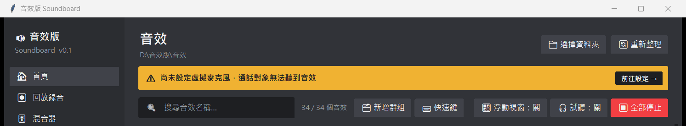
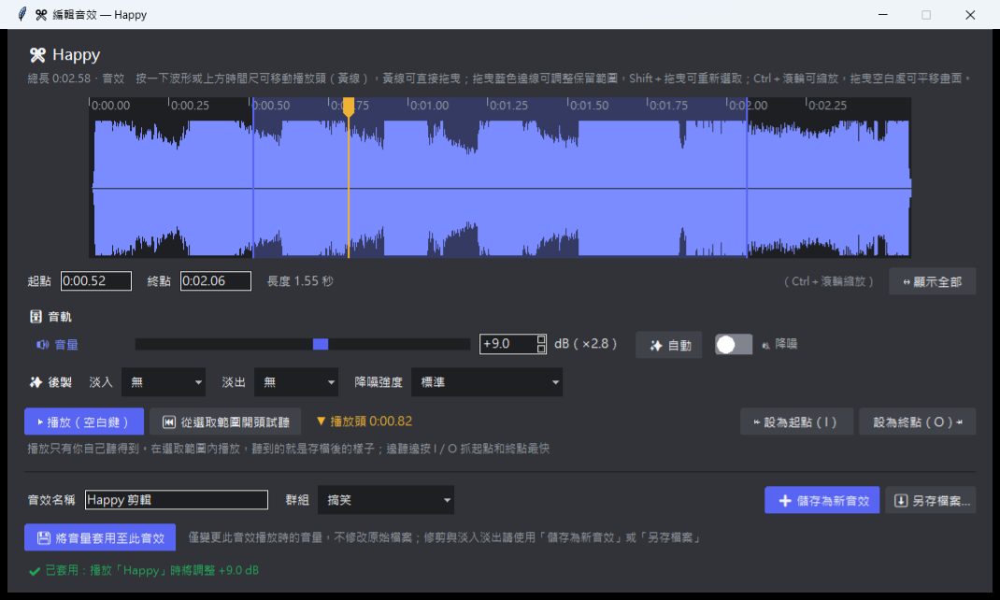
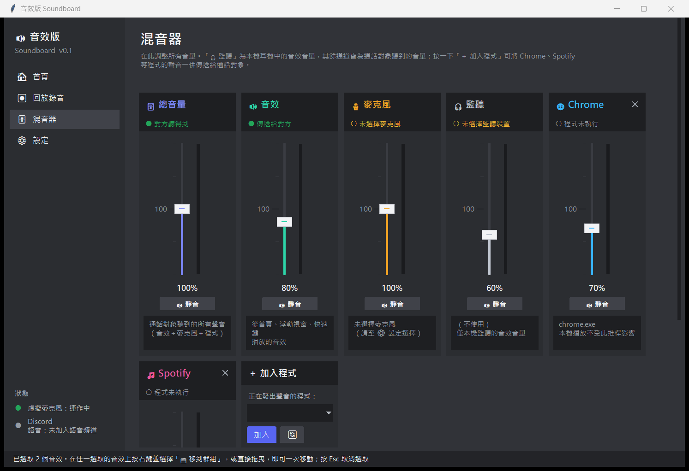
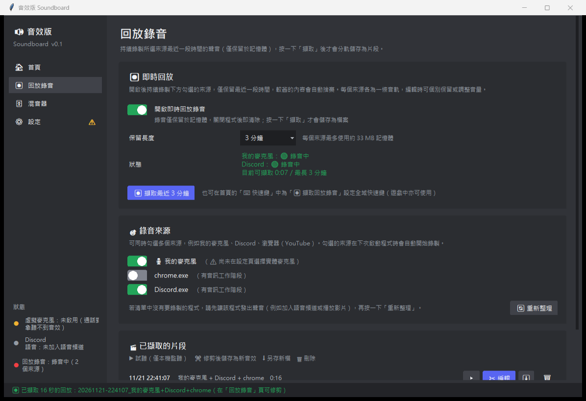
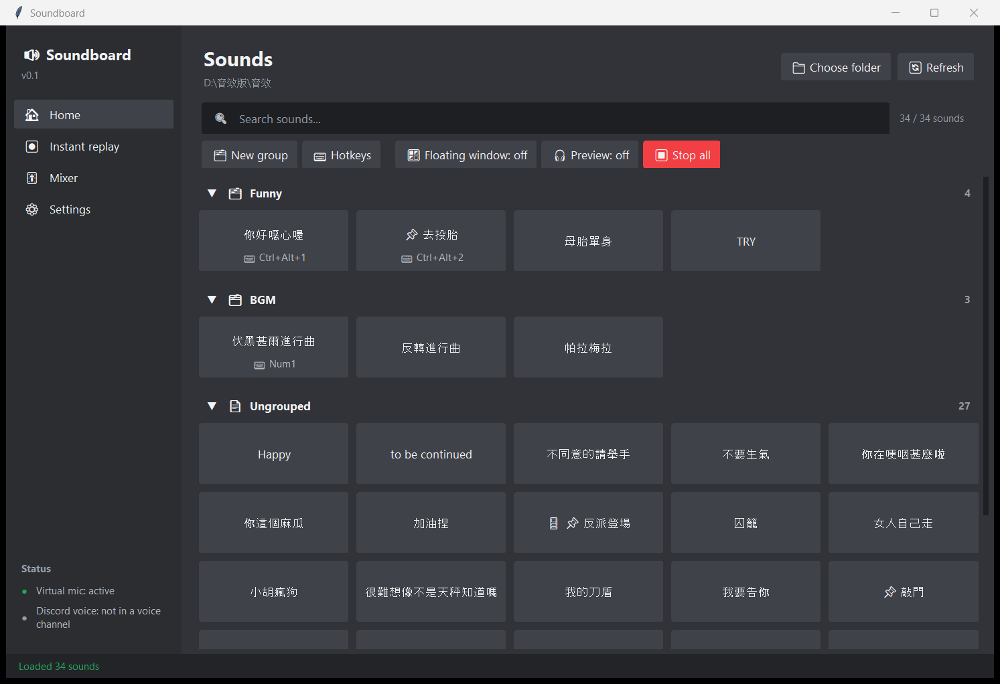
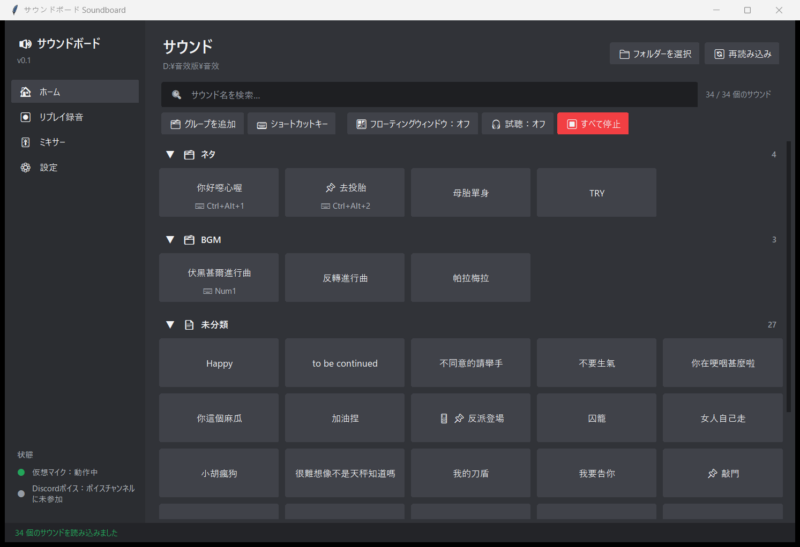

# 🔊 Soundboard (音效版)

**English** | [繁體中文](README.zh-TW.md)

This app was made so that **users without Discord Nitro** can also enjoy a soundboard and add more fun to playing with friends. Key features:

- **Your own soundboard, with no length limit**: Just put audio files in a folder and use them, without Discord's soundboard length limit
- **Instant replay recording and editing**: Capture the last few minutes of audio at any time and trim it directly into a new sound, making it faster and easier to create sounds
- **Join sound**: A feature normally reserved for Discord Nitro users, which you can also set up in this app, playing automatically when you join a voice channel
- **Mixer**: Send the audio of programs that are currently playing, such as music or a Podcast, directly through voice chat to the people you are talking with
- **Microphone noise suppression**: Processes only your microphone audio, without affecting the sounds or the Mixer audio

> ⚠️ **Note: Please turn off Discord's built-in "Automatically determine input sensitivity" and "Noise Suppression"**, otherwise Discord will filter out the sounds and the Mixer audio.
> After turning them off, enable Soundboard's "🔇 Microphone noise suppression" to get results similar to Discord's built-in noise suppression (see "Discord Setup" below).

## How It Works

A Discord-style soundboard for Windows desktops. The app lists the audio files in a folder as buttons, and a single click does **both** of the following at the same time:

1. Plays the sound through your headphones (monitoring)
2. Sends it to a "virtual mic" (so the people in your Discord or in-game voice chat can hear it)

The app also mixes in your **physical microphone**, so the people you talk to hear your voice and the sounds together. The microphone audio can optionally go through noise suppression.

```
Sounds ────────────────────────┬──> Headphones / speakers (monitoring)
                               └──> CABLE Input ──┐
Physical mic ──> Noise suppression ───────────────┴─(mix)─> CABLE Output ──> Discord "Input Device"
```

Current version: **0.1** (shown in the sidebar and under "⚙ Settings → ℹ About").

---

## 1. Prerequisite: Install a Virtual Audio Cable (one time only)

Windows does not let ordinary programs send audio directly into a physical microphone, so you need to install a free **virtual audio cable**:

1. Download **VB-CABLE Virtual Audio Device** (free) from the VB-Audio website: <https://vb-audio.com/Cable/>
2. Extract the archive, run `VBCABLE_Setup_x64.exe` **as administrator**, and click *Install Driver*
3. **Restart your computer** after the installation finishes

Two new devices are added to your system:

| Device | Type | Purpose |
|---|---|---|
| `CABLE Input (VB-Audio Virtual Cable)` | Playback device | Soundboard sends audio to this device |
| `CABLE Output (VB-Audio Virtual Cable)` | Recording device | Discord records from this device (used as the microphone) |

> 💡 Other virtual audio cables such as VoiceMeeter also work. The app automatically detects devices whose names contain `CABLE Input` or `VoiceMeeter Input`; if none is detected, you can select one manually.

---

## 2. Install the App

Requires Windows 10/11 and Python 3.10 or later. After downloading the source code, install it from the project folder:

```powershell
git clone https://github.com/Hou-Bo-Wei/Soundboard.git
```

```powershell
cd Soundboard
```

```powershell
pip install -e .
```

> 💡 The repository does not include any sound files. Put your own sound files in the sound folder (by default the project folder, or one you specify with a command-line argument; see "3. Launch" below).

### Supported Formats

| Format | Requirement |
|---|---|
| `.ogg` `.mp3` `.wav` `.flac` `.opus` `.oga` `.aif/.aiff` `.au` `.caf` `.w64` | Supported directly (built-in libsndfile) |
| `.m4a` `.aac` `.wma` `.webm` `.mp4` `.mka` `.amr` `.ac3` `.mp2` `.3gp` | Requires **ffmpeg** |

If ffmpeg is not installed yet, install it using either of the following:

```powershell
winget install Gyan.FFmpeg
```

```powershell
pip install -e ".[ffmpeg]"
```

(The second method installs `imageio-ffmpeg`, which bundles the ffmpeg executable.) All sounds are automatically converted to 48 kHz stereo when loaded, so files with different sample rates or mono files can be mixed freely.

---

## 3. Launch

- Double-click **`啟動音效版.bat`** (the "launch Soundboard" batch file; it uses the current folder as the sound folder and does not show a command prompt window), or
- Use the command line:

```powershell
python -m soundboard
```

```powershell
python -m soundboard "D:\我的音效"
```

List all audio devices and supported formats (for debugging):

```powershell
python -m soundboard --list-devices
```

Open the "🎙 Microphone test" window directly on launch (also works with the exe version: `Soundboard.exe --mic-test`):

```powershell
python -m soundboard --mic-test
```

---

## 4. Interface and Settings (First Use)

### Layout


The window is divided into the following areas:

| Area | Contents |
|---|---|
| **Left navigation bar** | Switches between the four pages: "🏠 Home", "⏺ Instant replay", "🎚 Mixer" and "⚙ Settings". A yellow ⚠ appears next to "⚙ Settings" when there is a problem with your settings. The app name and version (`Soundboard v0.1`) are shown at the top. The **Status** area at the bottom always shows "Virtual mic: active" / "Virtual mic: not enabled" and the "Discord voice" state; it shows "Preview mode: local monitor only" when preview mode is on, and sources such as "Instant replay: Discord" when instant replay is on (click a status to jump to the corresponding page) |
| **🏠 Home** | The sounds themselves: a search box, sound buttons divided into groups, and the common actions: 📁 Choose folder, 🔄 Refresh, 🗂 New group, ⌨ Hotkeys, 🪟 Floating window, 🎧 Preview, ⏹ Stop all |
| **⏺ Instant replay** | Continuously records the last few minutes of audio from several sources (your microphone, Discord, YouTube, etc.). Click "Capture" to save it as a multitrack clip, which you can then pick tracks from, adjust the volume of, and trim into a new sound |
| **🎚 Mixer** | All volumes in one place: faders for master, sounds, microphone and monitor, plus the ability to send the audio of apps such as Chrome and Spotify to the people in your call |
| **⚙ Settings** | Divided into six cards: 🎧 Audio devices, 🎙 Microphone and noise suppression, 🚪 Join sound, 🖥 Startup and background, 🌐 Language, ℹ About (adjust volume in "🎚 Mixer") |
| **Status bar** (bottom) | Recently played sounds, error messages and operation hints |

The window can be freely resized: when the width is insufficient, the Home toolbar buttons automatically wrap to the row below the search box, and the number of columns of sound buttons adjusts accordingly.
On high-DPI displays (125%, 150%, etc.), buttons and spacing scale proportionally.

**Home tells you clearly when the people in your call cannot hear the sounds**: if the virtual mic has not been set up (or the Windows default playback device is the virtual audio cable),
a yellow banner "No virtual mic set; others can't hear sounds" appears at the top of Home. Click "Go to Settings →" to jump to the Settings page:



### Settings Page

Click "⚙ Settings" on the left. All changes **take effect immediately and are saved automatically** (except the interface language, which requires a restart):


**🎧 Audio devices** (the current status appears at the top of the card: yellow text indicates a problem and how to fix it; green text means the virtual mic is active)

| Field | How to choose |
|---|---|
| **Audio API** | Defaults to `Windows WASAPI` (lowest latency). If a device cannot be opened, switch to `Windows DirectSound` or `MME` |
| **🎧 Monitor device (headphones/speakers)** | Headphones, speakers, or "(System default)"; choosing "(None)" means only the people in your call can hear the sounds. The list **does not include the virtual audio cable** (choosing it would make monitoring impossible); if the Windows default playback device is CABLE Input, "System default" automatically falls back to your physical headphones |
| **🎙 Virtual mic output** | `CABLE Input (VB-Audio Virtual Cable)` (usually selected automatically after installation) |
| **🗣 Physical microphone** | The microphone you normally speak into |
| 🔄 Rescan devices | The app **automatically** updates the device list when you plug or unplug headphones or speakers; you can click it manually right after installing a driver such as VB-CABLE |
| Switch: Mix microphone into virtual mic | When on, the people in your call hear your voice and the sounds together; when off, they hear only the sounds |
| Switch: Allow multiple sounds to play at once | When off, any sound that is playing stops before a new one plays |

> Scrolling the mouse wheel over the Settings page does **not** accidentally change a device when the pointer passes over a drop-down menu (the wheel only scrolls the page).

### Volume

**All volumes are adjusted in "🎚 Mixer" on the left** (the Settings page has no volume sliders, to avoid duplication):

| Channel | What it controls |
|---|---|
| 🎚 Master | Everything the people in your call hear |
| 🔊 Sounds | The volume of sounds sent to the virtual mic; **if the people in your call say the sounds are too loud or too quiet, adjust this channel** |
| 🎙 Microphone | The volume of your voice (as heard by the people in your call) |
| 🎧 Monitor | Affects only the sounds you hear in your headphones, not the people in your call |

- Range 0–200%; drag the fader, or hover over it and **use the mouse wheel** to adjust in 5% steps, or **double-click** to reset to 100%
- Above 100%, the app suppresses peaks with a **soft limiter**, so you do not get harsh clipping
- If a single sound is too loud or too quiet: right-click it and choose "✂ Edit / post-process…" to adjust its volume (see "Editing Sounds" below)
- Volumes are saved automatically; see "🎚 Mixer" below for details

**🎙 Microphone and noise suppression**, **🚪 Join sound**, **🖥 Startup and background**, **🌐 Language** and **ℹ About** are in the lower half of the Settings page (scroll down); see "🔇 Microphone Noise Suppression", "🎙 Microphone Test", "🚪 Join Sound", "🖥 Start with Windows and Background Running" and "🌐 Language and ℹ About" below:


### Discord Setup

Open **Discord → User Settings → Voice & Video**:

- Set **Input Device** to `CABLE Output (VB-Audio Virtual Cable)`
- Leave the output device as your usual headphones
- **Turn off Discord's "Noise Suppression" (both Krisp and Standard)**, otherwise the sounds will be filtered out as noise;
  let Soundboard's "🔇 Microphone noise suppression" handle noise such as keyboard sounds instead (see below). Noise suppression only processes the microphone audio and does not affect the sounds
- When "Input Mode" is set to "Voice Activity", **turn off "Automatically determine input sensitivity"** and lower the sensitivity manually, otherwise the sounds and the Mixer audio may be cut off;
  alternatively, use "Push to Talk" (sounds are only sent while you hold the key)

Settings are saved automatically in `%APPDATA%\Soundboard\settings.json`, so you do not need to set things up again the next time you open the app.

---

## 5. Usage

All of the following actions are performed on **🏠 Home**:

| Action | Function |
|---|---|
| Left-click a sound button | Sends the sound to the people in your call and monitors it (a playing button turns **blue**) |
| **Shift + left-click** | Preview: plays locally only, the people in your call cannot hear it (a playing button turns **green**) |
| Toolbar "🎧 Preview: off" button or `Ctrl+P` | Turns on preview mode, in which **left-click also plays locally only** and a green frame appears around the button area; click again to turn it off |
| Right-click → "▶ Play (others + monitor)" | Same as left-click |
| Right-click → "🎧 Preview (local only)" | Same as Shift + left-click |
| Right-click → "✏ Rename… (also changes file name)" | **Directly changes the file name on disk** (the extension stays the same), for example to give a recognizable name to a numeric file name downloaded from Discord; the volume, hotkey, floating window and group settings carry over to the new file name automatically |
| Right-click → "✂ Edit / post-process…" | Preview while adjusting the volume (−80 to +80 dB), keep only the middle portion, apply fades, and save as a new sound or save as a file (see "Editing Sounds" below) |
| Right-click → "📂 Show in File Explorer" | Opens the location of the sound file |
| Right-click → "🗑 Delete sound…" | After confirmation, deletes the sound **together with the file on disk** (the file is moved to the Recycle Bin and can be restored); see "Deleting Sounds" below |
| Right-click → "⌨ Set global hotkey…" | Assigns a key combination that **also works in games** (see "Global Hotkeys" below); once set, "⌨ Clear hotkey" is available |
| Right-click → "📌 Add to floating window" | Places the sound in the semi-transparent floating window in a screen corner (see "Floating Window" below) |
| Right-click → "🚪 Set as join sound" | Plays automatically when you join a Discord voice channel (see "Join Sound" below) |
| Right-click → "🗂 Move to group" | Moves the sound into a group (see "Sound Groups" below) |
| **Ctrl + left-click** | Multi-select sounds (a ☑ appears in front of the button and the border turns blue), then right-click and choose "🗂 Move to group" or simply drag to move them all at once; press `Delete` to delete them all at once; press `Esc` to clear the selection |
| `Esc` or "⏹ Stop all" | Immediately stops all sounds |
| 🔍 Search | Filters buttons by name or file name |
| 📁 Choose folder / 🔄 Refresh | Changes the sound folder / re-reads it after adding files (including subfolders); the current folder is shown under the "Sounds" heading |

> For the volume of an individual sound, use the volume setting in "✂ Edit / post-process…" (the right-click menu no longer offers "⏹ Stop this sound" or "🔊 Adjust volume (±dB)…"; to stop playback, use `Esc` or "⏹ Stop all").

### ✂ Editing Sounds (volume ±80 dB, trim, save as)

Downloaded sounds often have inconsistent volumes. Right-click a sound and choose "**✂ Edit / post-process… (trim, volume, fades, save as)**" to open the same editor used for instant replay clips:



**Volume**
- Use the slider or type a dB value directly in the field (for example `-12` or `+6.5`). The range is **−80 to +80 dB**, and 0 is the original volume;
  +6 dB is roughly double the volume and −6 dB is roughly half
- "✨ Auto" adjusts the sound to the loudness of a typical sound effect (calculated over the selected range), which makes it easy to even out the volume of different sounds
- Click "**💾 Apply volume to this sound**": from then on, this volume is used whenever the sound is played from Home, the floating window, a hotkey or as a join sound.
  **The original file is not modified**, and you can set it back to 0 dB at any time
- Peaks that exceed full scale after amplification are smoothly suppressed by a peak limiter, so there is no distortion; what you hear when previewing in the editor is exactly what will be played

**Trimming and post-processing** (the controls are the same as in the instant replay clip editor: click the waveform to move the playhead, drag the blue edges to adjust the range, press Space to play, press I / O to set the start and end, and Ctrl + scroll to zoom)
- For example, to keep only one sentence in the middle: drag the blue edges to that portion, or press I / O while previewing
- Fade in / fade out, and 🔇 Noise suppression (for voice)
- "**➕ Save as new sound**": writes the volume, trim and post-processing result to a new file (`.ogg`), and adds a new button to Home, placed by default in the group of the original sound;
  the original sound stays unchanged, and you can delete it yourself if you no longer need it
- "**⬇ Save as…**": saves to any location in ogg / mp3 / wav / flac format

### Preview Mode

When you need to pick a sound first and do not want the people in your call to hear it:

1. Click "🎧 Preview: off" on the Home toolbar (or press `Ctrl+P`). The button turns green and reads "🎧 Preview: on (local only)", and the Status area in the sidebar also shows "Preview mode: local monitor only"
2. Now clicking any sound plays it locally only; the people in your call cannot hear it at all (it is not sent to the virtual mic)
3. When you are done picking, click again to turn preview mode off, and left-click goes back to sending sounds to the people in your call

> Preview mode is not remembered; it is always off each time the app starts, so you never mistakenly assume the people in your call can hear it.
> Previewing requires headphones or speakers to be selected under "⚙ Settings → 🎧 Monitor device (headphones/speakers)"; if it is set to "(None)", the status bar shows a hint.

| Button color | Meaning |
|---|---|
| Gray | Not playing |
| Blue border + ☑ | Selected with Ctrl + left-click |
| 🟦 Blue | Playing; the people in your call can hear it |
| 🟩 Green | Previewing; local monitor only |

### Renaming (Also Changes the File Name)

Right-click a sound, choose "✏ Rename… (also changes file name)" and enter a new name. **The file on disk is renamed too** (the extension stays the same, for example `.ogg`).

- The volume, hotkey, floating window and group settings previously assigned to this sound carry over to the new file name, so there is nothing to set up again
- The name cannot contain `\ / : * ? " < > |`, cannot end with a space or period, and cannot match another file in the same folder;
  if the name is invalid, an explanation is shown and the text you entered is kept so you can fix it
- A file that is in use by another program (for example a media player) cannot be renamed; close that program and try again

### 🗑 Deleting Sounds (Together with the File)

You can delete unwanted sounds directly in Soundboard, without having to look for the file in a folder:

1. Right-click a sound and choose "🗑 Delete sound… (file moves to the Recycle Bin)" (or first multi-select several sounds with **Ctrl + left-click** and then right-click and choose "🗑 Delete these N sounds…", or simply press the `Delete` key)
2. The confirmation window lists the sounds to delete and the file locations; the sounds are deleted only when you click "Yes" (the default button is "No")

- **The files on disk are deleted too**, but they are **moved to the Recycle Bin**: if you delete something by mistake, click "Restore" in the Recycle Bin and then click "🔄 Refresh" in Soundboard to bring it back
  (hotkeys, groups and other settings must be set up again)
- The sound's hotkey, group, floating window, volume and join sound settings are removed as well; a sound that is playing is stopped first, and any open editor window is closed
- If the file is in a location without a Recycle Bin (for example a network drive), you are asked again whether to delete it permanently (this cannot be undone)
- "🗑 Delete group" in the group right-click menu only deletes the group and does **not** delete the sound files

### Sound Groups

When you have many sounds, you can organize them into groups such as "Funny", "Horror" and "Games", and Home displays them in sections by group:


1. Click "🗂 New group" on the Home toolbar and enter a group name
2. **Move several sounds at once**: hold `Ctrl` and click the sounds to move (a ☑ appears in front of the buttons),
   right-click any selected sound, choose "🗂 Move to group (N selected)" and pick a group
3. To move just one sound: right-click that sound and choose "🗂 Move to group"
4. **Drag sounds with the mouse**: press and hold a sound button, drag it onto a group header (or anywhere within a group) and release to move it into that group;
   the header turns blue to indicate it will be dropped there. If you release on top of a sound, the dragged sound is **inserted before that sound**, which you can use to reorder sounds within a group.
   Multi-select with `Ctrl` first and then drag to move several sounds at once; drag to "Ungrouped" to remove sounds from a group
5. **Drag group headers with the mouse to reorder groups**: press and hold a group header and drag up or down; a blue line marks the insertion position, and when you release, the group moves there.
   "Ungrouped" cannot be dragged; groups cannot be dragged while searching (some groups are hidden, so insertion positions cannot be mapped)

| On a group header | Function |
|---|---|
| Left-click | Collapse / expand (►/▼); the state is remembered |
| Left-drag | Reorder groups (a blue insertion line is shown) |
| Right-click → "✏ Rename group…" | Changes only the group name; sound files are not affected |
| Right-click → "⬆ Move up" / "⬇ Move down" | Reorders groups |
| Right-click → "📌 Add whole group to floating window" | Adds all sounds in the group to the floating window at once |
| Right-click → "🗑 Delete group" | Sounds in the group move back to "Ungrouped"; **files are not deleted** |
| Right-click → "Expand all" / "Collapse all" | Expands or collapses all groups at once |

- A sound belongs to only one group at a time; moving it into a new group automatically removes it from the old one, and choosing "↩ Remove from group (Ungrouped)" moves it back to Ungrouped
- Dragging to the top or bottom edge of the scroll area scrolls automatically; if you release without having moved after pressing, it is still treated as an ordinary click (playing the sound or collapsing the group)
- While searching, groups that contain matches are expanded automatically and groups with no matches are hidden
- Groups are only a classification inside the app and **do not move files**; if a file is temporarily moved away, the group keeps its entry, and it appears again once the file is put back

### Global Hotkeys (Also Work in Games)

Play a sound by pressing a hotkey, without leaving your game:

1. Right-click a sound button and choose "⌨ Set global hotkey…"
2. Press the key combination you want, for example `Ctrl+Alt+1`, `Num1` (numeric keypad) or `F13`; press `Esc` to cancel
3. Once set, `⌨ Ctrl+Alt+1` is shown below the button, and pressing it in a game plays the sound

"⌨ Hotkeys" on the Home toolbar lets you view and edit all hotkeys in one place, and also lets you set the following **action hotkeys**:

| Action | Description |
|---|---|
| ⏹ Stop all | Immediately stops all sounds while in a game |
| 🪟 Show/hide floating window | For example, set it to `Ctrl+Alt+O` to show the floating window only when needed |
| 🎧 Toggle preview mode | When on, sounds played by hotkey also play locally only |
| 🗂 Switch floating window to next group | Switches the floating window to the next group (also shows it if it is hidden) |
| ⏺ Capture instant replay | Captures the most recent audio of instant replay (see "Instant Replay" below) |

Notes:

- Hotkeys are **intercepted** by Soundboard, so the game does not receive that key; avoid keys the game uses. Ctrl/Alt combinations, the numeric keypad or F13–F24 are recommended
- If a letter or number key without Ctrl/Alt is assigned, you will not be able to type that character anywhere; the app shows a warning when you set it
- A key combination can be assigned to only one sound; assigning it to a new sound automatically removes it from the original sound
- If the status bar says a hotkey is "already used by other programs", that key combination has been registered by other software (for example Discord or graphics card software); choose a different combination
- If the game runs **as administrator**, Soundboard must also run as administrator in order to receive hotkeys

### Floating Window (A Semi-Transparent Soundboard in a Screen Corner)

1. Right-click the sound you want to add and choose "📌 Add to floating window" (the button then shows 📌)
2. Click "🪟 Floating window: off" on the Home toolbar to show it (when on, the button turns blue and reads "🪟 Floating window: on"); by default it is in the bottom-right corner of the screen
3. Using the floating window (the screenshot below shows it with preview mode on):

   


| Action | Function |
|---|---|
| Left-click a sound | Plays it (local only when preview mode is on) |
| Shift + left-click | Preview |
| Drag the title bar | Moves the window (the position is remembered) |
| `◀` / `▶`, or the mouse wheel over the group name | **Switches groups**: 📌 Pinned sounds → Group 1 → Group 2 → … |
| Click the group name | Lists all groups so you can pick one directly |
| `⋮`, or right-click the title bar | Adjusts **opacity** (30%–100%), buttons per row, moves to a corner, shows group |
| `⏹` / `✕` | Stop all / hide the floating window |

- Once you have created groups, the floating window gains a row `◀ Group name ▶` that lets you switch between "📌 Pinned sounds" and each group:

  

- You can also set the action hotkey "🗂 Switch floating window to next group" to switch directly in a game
- The floating window is always on top and **does not steal focus from the game when clicked**, so you can keep controlling the game right after clicking
- When preview mode is on, the floating window's title bar turns green and reads "🎧 Previewing (local only)"
- The floating window can only be shown over games in "**borderless windowed**" or windowed mode; **exclusive fullscreen** games cover the floating window (use global hotkeys in that case)

### 🚪 Join Sound (Plays Automatically When You Join Discord Voice)

Similar to the join sounds in Discord Nitro, a chosen sound is played automatically to the people in your call when you join a voice channel:

1. Right-click a sound and choose "🚪 Set as join sound (plays when you join Discord voice)" (a 🚪 appears in front of the button)
2. Turn on the "Play when joining a Discord voice channel" switch under "⚙ Settings → 🚪 Join sound" (it is turned on automatically when you set a join sound)
3. After you join any voice channel, the sound plays after about 1.5 seconds; you can press "▶ Test play" first to check it

- The "Detection status" on the same card (and the Status area at the bottom of the sidebar) shows "Discord voice: 🟢 In a call" / "Discord voice: not in a voice channel"
- "Delay" is the number of seconds to wait after joining before playing: if it plays too early, Discord may not have finished connecting and the people in your call will miss the beginning; if you cannot hear it, increase the delay
- The join sound is always sent to the people in your call and is not affected by preview mode
- **It plays only at the moment you "join"**: if you are already in a voice channel when Soundboard starts, it does not play; when testing, leave the voice channel first and then rejoin

**How detection works and its limitations**: Discord only opens the microphone when you are in a voice channel. Once per second, Soundboard queries the Windows audio session API
for "which programs are recording audio" (the microphone-in-use icon in the taskbar uses the same information); when it detects that Discord has started recording, you have joined a voice channel.
This method requires no Discord login and does not violate Discord's Terms of Service. As a result:

- Clicking "Test Mic" in Discord's settings is also treated as joining a voice channel
- Switching directly between voice channels (for example from your own channel to another one) also plays the sound; a brief disconnection and reconnection within 3 seconds plays it only once, to avoid repeated playback when the network is unstable

### 🎚 Mixer (Send the Audio of Chrome, Spotify, etc. to the People in Your Call)

"🎚 Mixer" in the left navigation bar: each sound source has its own channel, and just like a mixing console you adjust the volume **that the people in your call hear** with a fader.



| Channel | Audio it controls |
|---|---|
| 🎚 **Master** | Everything the people in your call hear (sounds + microphone + apps); when muted, the people in your call hear nothing |
| 🔊 **Sounds** | Sounds played from Home, the floating window and hotkeys (the volume the people in your call hear) |
| 🎙 **Microphone** | Your voice (after noise suppression); muting is equivalent to turning off "Mix microphone into virtual mic" on the Settings page |
| 🎧 **Monitor** | The volume of sounds in your local headphones (does not affect the people in your call); when muted, you hear no sounds locally |
| 🌐 **Chrome** and other apps | Apps you have added: their audio is sent to the people in your call in real time |

**Sending an app's audio to the people in your call**:

1. First make the app produce sound (for example, play YouTube in Chrome)
2. In the "+ Add app" drop-down menu, choose the app (click 🔄 if it is not listed; you can also type the executable name directly, for example `spotify.exe`), then click "Add"
3. When "● Sending to others" appears above the channel, you are done; when the app is closed it shows "○ App not running", and it reconnects automatically the next time the app is opened

- Fader: drag or click to set (0–200%; above 100% the soft limiter engages automatically, so there is no clipping); hover over the fader and use the **mouse wheel** to adjust 5% per notch; **double-click** to reset to 100%
- The **level meter** to the right of the fader: green is normal, yellow is loud, red is close to the limit
- "🔊 Mute" only silences the audio for the people in your call (after clicking it shows "🔇 Muted"), and local playback is completely unaffected; click the ✕ in the upper-right corner of a channel to remove that app
- **You still hear the app's audio from your speakers or headphones as usual**: the Mixer only sends an extra copy into the virtual mic and does not change what you hear locally
- Only the apps you have added are captured (including their child processes, so all Chrome tabs are sent); other apps are not affected
- **Discord cannot be added**: the voices of the people in your call would be sent back, causing echo
- Requires Windows 10 2004 or later (it uses the same technology as instant replay); for the people in your call to hear anything, "Virtual mic output" must be set first (a hint is shown at the top of the page)
- Settings (added apps, volumes, mute) are saved automatically and restored the next time the app starts

### 🖥 Start with Windows and Background Running (System Tray)

Keep Soundboard on standby in the background so you do not need to open it separately before playing a game:


- **Start Soundboard when Windows starts**: starts automatically in the background after you sign in to Windows (it is registered as a startup item for the current user and needs no administrator rights;
  "Soundboard" also appears under Windows "Task Manager → Startup apps", where you can disable it)
- **Don't show the window at startup; show only in the system tray** (on by default): after startup, only the Soundboard icon appears in the system tray at the lower right, and the main window is not opened
- **Minimize to the system tray when clicking ✕, and keep running in the background** (on by default): after you close the main window, the app keeps running in the background, and **hotkeys, the floating window, join sound and instant replay all keep working**;
  a notification is shown the first time you click ✕
- System tray icon: **click** to open the main window; **right-click** to choose "Show Soundboard", "Floating window", "Preview mode (local monitor only)", "Stop all" or "Quit Soundboard" (a check mark on "Floating window" or "Preview mode" means it is on)
- **To quit the app completely**: right-click the system tray icon and choose "Quit Soundboard", or click "⏻ Quit Soundboard" on the Settings page
- If you open `Soundboard.exe` again while Soundboard is already running in the background, no second instance is started; the existing window is shown instead
- After moving the exe to another folder, run the exe in the new location once and the startup item is updated automatically;
  if the card shows "A Soundboard at a different location will start at boot", turn the switch off and on again to start the current version instead

### 🔇 Microphone Noise Suppression (Replaces Discord's Noise Suppression)

When using Soundboard you must turn off Discord's noise suppression (otherwise the sounds are filtered out), but then keyboard sounds and fan noise are picked up as well.
Soundboard has built-in **RNNoise** open-source AI noise suppression (the noise suppression built into OBS uses this same technology), and it **processes only the physical microphone; sounds never pass through noise suppression**:

| Setting | Effect |
|---|---|
| Off | Original audio |
| Standard (default) | Removes constant noise (fans, air conditioners, electrical hum) and most background sound; voice is almost unaffected |
| Strong (suppresses keyboard noise) | Standard + a **voice gate**: when the AI decides you are not speaking, the output is **completely silent**, so keyboard and mouse sounds are not sent; the gate opens only when you speak (10 ms lookahead preserves the start of words, and it holds for 0.25 seconds after you finish to preserve the ends) |

- Choose the noise suppression strength under "⚙ Settings → 🎙 Microphone and noise suppression"; when "Strong" is chosen, the right side of the drop-down shows "🎙 Sending" or "🔇 Muted (no voice detected)" in real time: when you only type without speaking it should show "Muted"
- **If you type while speaking**, keyboard sounds are sent along with your voice (the gate is open at that moment), and even Krisp has difficulty handling this fully
- Noise suppression adds about 30 ms of latency (about 40 ms for "Strong") and uses very little CPU (about 5% of a single core)
- Noise suppression keeps only voice, so do not play music to the people in your call through the microphone (it is treated as noise and suppressed); play music through Soundboard instead

### 🎙 Microphone Test (Waveform, Before/After Recording Comparison)

Click "🎙 Microphone test (waveform / recording comparison)" under "⚙ Settings → 🎙 Microphone and noise suppression" to open it, and check visually and by ear whether keyboard sounds are being filtered out:


- **Two waveforms**: yellow is the **original audio** picked up by the microphone, and green is the audio **after noise suppression** (what the people in your call hear). A dB scale is used so that even quiet noise is visible
- "**Background noise**" in the upper right is the volume while you are not speaking: the original is about −50 dB, and when noise suppression is effective it becomes very low or shows "silent"
- **Recording comparison**: click "⏺ Start recording", then in order stay quiet for 2 seconds, tap the keyboard a few times, say a few sentences, and talk while typing, then click "⏹ Stop recording" (up to 15 seconds);
  afterwards compare by alternating between "▶ Play original" and "▶ Play suppressed"; the playback position is shown on the waveform during playback
- After a recording is finished, **changing the noise suppression strength above recalculates immediately**, so you can compare "Standard" and "Strong" without recording again
- "👂 Live preview (play noise-suppressed mic audio through headphones)" lets you hear the noise-suppressed microphone audio in your headphones in real time (about 30 ms latency); it turns off automatically when the test window is closed
- Recording and playback happen **locally only (local monitor only)**; nothing is sent to the virtual mic and nothing is saved to a file

### ⏺ Instant Replay (Record What the Other Person Just Said and Edit It into a New Sound)

When someone in your call says something worth keeping, click "Capture" to save the **last few minutes** of audio, then cut out the few seconds you need to make a new sound button.



1. Open the "⏺ Instant replay" page and turn on "**Turn on instant replay recording**"
2. Under "🎯 Recording sources", check the sources to record; **you can check several at the same time**:
   - **🎙 My microphone**: the physical microphone selected on the Settings page; it records the **noise-suppressed audio that the people in your call hear**
   - **Discord.exe**: the voices of the people in your voice channel
   - **chrome.exe / msedge.exe** (YouTube, etc.), games, music players and any other program that makes sound

   Only the checked sources are recorded; unchecked programs are never recorded. If a program is not in the list, make it produce sound first and then click "🔄 Refresh"
3. Under "Keep length", choose how much to keep (30 seconds to 10 minutes, default 3 minutes). Anything older is discarded automatically and is **kept only in memory, never written to disk**
4. When you want to save something, click "**⏺ Capture last 3 min**" (or set "⏺ Capture instant replay" under "⌨ Hotkeys" so you can use it in games too).
   **Each source is saved as a separate track** and appears under "🎬 Captured clips"
5. For a clip you can click ▶ to preview it (local monitor only, volume adjusted automatically), ⬇ to save it as ogg / mp3 / wav / flac, 🗑 to delete it, or click "✂ Edit" to post-process it:


**Playhead and selection** (the same as in video editing software)
- Each source has its own waveform, so you can see who spoke and when

| Mouse | Effect |
|---|---|
| **Click** the waveform or the time ruler above | Moves the **playhead** (yellow line) there without changing the selection; clicking during playback jumps there and continues playing |
| **Drag the yellow line** (within a few px of the yellow line, or the yellow handle on the time ruler) | Moves the playhead; **you can also drag during playback**, and playback continues from the new position when you release |
| **Drag the blue edges** | Adjusts the range to keep (start / end); you can also type times directly in "Start" / "End" (for example `12.5` or `1:05.2`) |
| **Shift + drag** | Reselects a range |
| **Ctrl + scroll** | Zooms in / out centered on the mouse position (down to 0.2 seconds visible), making it easier to set the start and end precisely; click "↔ Show all" to show the whole clip again |
| **Dragging empty space** / scrolling while zoomed in | Pans the view left and right; during playback the view pages automatically when the playhead leaves the screen |

| Action | Effect |
|---|---|
| **Space** / "▶ Play (Space)" | Plays from the playhead; press again to pause, and the playhead stays at the paused position |
| "⏮ Preview from start of selection" | Plays the finished result from the start of the selection |
| **I** / "⇤ Set start (I)" | Sets the selection start to the playhead position (press it while previewing for the fastest way to set cut points) |
| **O** / "Set end (O) ⇥" | Sets the selection end to the playhead position |
| **Home** | Moves the playhead to the very beginning |

- When the playhead is **inside the selection**, the finished result is played (including noise suppression and fades) and stops at the selection end;
  when it is outside the range, the tracks are played mixed at their current volumes until the end of the clip

**🎚 Tracks (adjust each track separately)**
- **Switch**: keep only the sources you need. For example, if you only want the other person's sentence and not the background music from YouTube, turn off the chrome track
- **🔊 Volume** (−24 to +30 dB): instant replay records the audio of a program "before its volume is adjusted", which is usually **more than 20 dB quieter** than what you normally hear,
  so when the editor opens **each track is already amplified automatically** to the volume of a typical sound effect; you can also drag the slider to adjust manually, or click "✨ Auto" to recalculate for the current selection
- The waveform scales with the volume in real time. The peak of the mixed result is smoothly suppressed below full scale by a **peak limiter**: the volume is only lowered slightly for a few tens of milliseconds around a peak,
  so there is no clipping and you can amplify with confidence; only when the gain exceeds about **15×** (about 21.6 dB above full scale) does the waveform turn **red** and "⚠ Volume too high; some parts will be heavily compressed" appear;
  go by what you hear when previewing for the actual result
- **🔇 Noise suppression**: uses RNNoise to remove keyboard and fan noise from that track (for voice, not for music). It processes only the selected range and is computed in the background;
  "Noise suppression strength" can be set to "Standard" or "Strong (mute when no speech)"

**✨ Post-process**
- **Fade in / fade out**: None to 2 seconds (even if you choose "None", 5 ms is added automatically at the start and end, so cutting from the middle of a sound does not produce a pop)

**Previewing and saving**
- Previewing plays locally only; if you change the volume or a track switch during playback, playback continues from the current position with the new settings
- Fill in "Sound name", choose a "Group", and click "**➕ Save as new sound**": it is saved to the sound folder in `.ogg` format, and a button is added to Home immediately
- "⬇ Save as…" saves the result to any location

**Performance** (measured): each recorded program uses about **0.3% of a single CPU core** (0.02% of the whole CPU); memory is about 11 MB per minute,
about 33 MB for a 3-minute keep length and about 110 MB for 10 minutes (one copy per source). Capturing 3 minutes and saving it to a file takes less than 1 second and happens in the background, so the interface does not stutter.

**Notes**

- A program's audio is the digital signal "before" it is sent to the speakers and is not affected by the speaker volume; Discord's audio contains only the people in your call, so to record your own voice check "🎙 My microphone"
- "My microphone" records the device selected under "⚙ Settings → 🗣 Physical microphone"; even if "Mix microphone into virtual mic" is off, that microphone is opened automatically while recording
- Clips are stored in the "回放片段" (replay clips) folder next to the settings file (`%APPDATA%\Soundboard\回放片段`, one folder per clip and one FLAC file per track);
  click "📂 Open clips folder" to open it
- Requires **Windows 10 2004 (19041) or later**; Discord or a browser reconnects automatically after being reopened
- Off by default. Please obtain the other person's consent before recording their voice

### 🌐 Language and ℹ About

**🌐 Language**: "Interface language" can be set to "Follow system", 繁體中文 (Traditional Chinese), English, 日本語 (Japanese) or 한국어 (Korean).
- "Follow system" is determined by the Windows display language (the language actually used is shown in parentheses); Chinese environments use Traditional Chinese, and unsupported languages use English
- After changing it you are asked "Soundboard must restart to apply the new interface language. Restart now?": choose "Yes" to restart immediately, or "No" to apply it the next time the app starts
- Text that has not been translated yet is shown in the original Traditional Chinese


The interface in each language (English / 日本語 / 한국어):

| English | 日本語 | 한국어 |
|---|---|---|
|  |  |  |

**ℹ About**: shows the version (for example "Soundboard version 0.1") and the location of the config file; click "📂 Open settings folder" to open the folder that contains the config file, log files and replay clips.

### Example: Playing a "Wow" Sound in Discord

1. Put `wow.mp3` in the sound folder and click "🔄 Refresh"
2. **Shift + left-click** the button to preview it and check the volume; if it is too loud, right-click it, choose "✂ Edit / post-process…", set the volume to `-6` dB and click "💾 Apply volume to this sound"
3. In a Discord voice channel, left-click the button, and both you and the people in your call hear it at the same time
4. Right-click it, choose "⌨ Set global hotkey…" and press `Ctrl+Alt+W`; from then on, pressing this combination in a game plays the sound
5. Right-click it, choose "📌 Add to floating window", and then turn on "🪟 Floating window" so you can click it directly in a screen corner

---

## 6. Troubleshooting

**The people in your call cannot hear the sounds**
- A yellow banner "No virtual mic set" appears at the top of Home: click "Go to Settings →", install VB-CABLE, click "🔄 Rescan devices" and choose `CABLE Input`
- Discord's input device is not set to `CABLE Output`
- Discord's noise suppression is filtering out the sounds: turn off Discord's noise suppression and use Soundboard's "🔇 Microphone noise suppression" instead
- Discord's input sensitivity is too high: lower it, or use Push to Talk

**An app added in the Mixer cannot be heard by the people in your call**
- The channel status is "○ App not running": the app must be running; apps such as Chrome reconnect automatically within about 2 seconds after being reopened
- Make sure "🎚 Master" or that channel is not muted and the fader is not at 0
- A yellow notice "No virtual mic set" appears at the top of the page: go to the Settings page and choose CABLE Input

**The people in your call say your voice or the sounds have disappeared**
- Check "🎚 Mixer": when "Master" is muted the people in your call hear nothing; when "Sounds" is muted they cannot hear the sounds

**Hotkeys still respond after clicking ✕, or Soundboard seems impossible to close**
- This is background running: clicking ✕ only minimizes the app to the system tray at the lower right. To quit completely, right-click the system tray icon and choose "Quit Soundboard"
- If you do not want this behavior: under "⚙ Settings → 🖥 Startup and background", turn off "Minimize to the system tray when clicking ✕, and keep running in the background"
- If you cannot find the icon in the system tray: click the "^" at the lower right of the taskbar to expand the hidden icons

**It did not start automatically at startup**
- See the explanation below the card under "⚙ Settings → 🖥 Startup and background": if it has been disabled in "Task Manager → Startup apps", a warning is shown; turn the switch on to re-enable it

**You cannot hear the sounds locally (but the people in your call can)**
- "🎧 Monitor device (headphones/speakers)" must not be set to CABLE Input; choose your headphones (the current version no longer lists the virtual audio cable, and old settings are corrected automatically)
- After installing VB-CABLE, Windows often sets **CABLE Input as the default playback device**. The app works around this automatically, but it is recommended to go to
  "Settings → System → Sound → Output" and set the default device back to your headphones; otherwise audio from games, YouTube and so on also flows into the microphone and is heard by the people in your call
- Make sure "🎧 Monitor" in "🎚 Mixer" is not at 0% or muted

**Hotkeys do nothing in a game**
- If the status bar says "already used by other programs", choose a different key combination
- If the game runs as administrator, Soundboard must also be "run as administrator"
- Make sure Soundboard is still running (hotkeys work only while the app is running)

**You cannot see the floating window**
- An "exclusive fullscreen" game covers the floating window; switch the game to "borderless windowed"
- The floating window is off-screen: click "🪟 Floating window" on Home twice, and it moves back within the screen area automatically

**The people in your call cannot hear your voice**
- Make sure "Mix microphone into virtual mic" under "⚙ Settings → 🎧 Audio devices" is on and "🗣 Physical microphone" is correct
- Raise the "🎙 Microphone" fader in "🎚 Mixer"

**You cannot find your speakers or headphones (for example USB or Bluetooth speakers you just turned on)**
- The app checks for device changes every 2 seconds, so within a few seconds of connecting, the device appears automatically in the "🎧 Monitor device (headphones/speakers)" list, and the status bar shows "Audio device change detected; device list updated automatically"
- If it still does not appear, click "⚙ Settings → 🔄 Rescan devices"; if it still does not, first confirm that the device is visible under Windows "Settings → System → Sound"
- If a previously selected device is temporarily not connected, the system default is used instead, and **it is selected again automatically once it reconnects**

**The join sound did not play**
- Check the detection status under "⚙ Settings → 🚪 Join sound" (or the Status area at the bottom of the sidebar): it should show "In a call" while you are in a voice channel
- It does not play if you were already in a voice channel when Soundboard started (it plays only on "joining"): leave the voice channel and rejoin
- If it shows "can't detect": the Windows audio service is malfunctioning; restart your computer and try again
- If it plays but the people in your call hear only the second half: increase "Delay" (for example to 2–3 seconds)

**Noise suppression is on, but the people in your call can still hear keyboard sounds**
- Switch to "Strong (suppresses keyboard noise)" and record a sample with "🎙 Microphone test" to confirm that the green waveform is flat while typing
- If the indicator on the Settings page keeps showing "🎙 Sending" while you only type, the AI is classifying keyboard sounds as voice: move the microphone farther away or lower the microphone sensitivity
- Make sure Discord's "Input Device" is `CABLE Output`; if you select the physical microphone directly, the audio does not pass through Soundboard's noise suppression
- Discord's "Automatic Gain Control" amplifies faint residual noise, so consider turning it off

**Noise suppression is on, but the people in your call say your voice cuts in and out**
- Switch to "Standard" ("Strong" attenuates segments it judges to be non-voice, and quiet speech may be misjudged)

**A device cannot be opened (red text in the status bar)**
- The device may be in use by another program in "exclusive mode", or it may have been unplugged; switch to another audio API (DirectSound / MME)

**You hear an echo of your own voice**
- Do not monitor CABLE Output with Windows "Listen to this device"

**A sound file does not appear in the list**
- Check that the extension is in the supported formats table; formats such as m4a / aac / wma require ffmpeg (the status bar shows a hint)
- Some .ogg files (output of certain recording or editing tools with timestamp errors) are corrected automatically and played, without needing ffmpeg

**Instant replay records no sound, or shows "Waiting"**
- Make sure the program you want to record is running and checked; for Discord, you must be in a voice channel and the other people must be speaking for there to be sound
- "My microphone: ⏸ Waiting" with "No sound received; check the physical microphone in Settings": go to "⚙ Settings" and make sure "🗣 Physical microphone" is correct and is not held exclusively by another program

**The recorded replay is very quiet**
- This is normal: it records the audio of a program "before its volume is adjusted". When the editor opens, each track is amplified automatically, and you can drag the "🔊 Volume" slider to amplify further
- If "⚠ Can't record" is shown: the Windows version is too old (Windows 10 2004 or later is required), or that program runs as administrator while Soundboard does not

**The interface language did not change**
- After changing "🌐 Language" you must restart Soundboard for it to take effect; if you chose "No" at the time, quit Soundboard completely (system tray icon right-click → "Quit Soundboard") and open it again

---

## 7. Build an exe to Share

Other users **do not need to install Python**; they only need a single `.exe`:

```powershell
pip install -e ".[build]"
```

```powershell
python packaging/build_exe.py
```

Output:

| File | Description |
|---|---|
| `release/音效版.zip` | **Send this file when sharing** (about 25 MB) |
| `release/音效版/Soundboard.exe` | Single executable (includes the English, Japanese and Korean translation files) |
| `release/音效版/音效/` | Empty folder ("音效" means "sounds"); put sound files here and the app reads them automatically |
| `release/音效版/使用說明.txt` | Setup instructions for users (VB-CABLE, Discord settings, usage) |

Notes:

- Users still need to **install VB-CABLE themselves**: it is a driver that requires administrator rights and cannot be included in the exe
- The exe has built-in support for formats such as `.ogg .mp3 .wav .flac .opus .aiff`; formats such as `.m4a .wma` require a separately installed ffmpeg
  (a full ffmpeg is about 220 MB, so it is not included)
- The exe is not digitally signed, so on first run Windows may show "Windows protected your PC"; click "More info → Run anyway"
- The exe version writes its error log to `%APPDATA%\Soundboard\soundboard.log`
  (rewritten at every launch; **when you reopen the app after it exited abnormally**, the previous log is in `soundboard.prev.log` in the same folder, and the state at the moment of the abnormal exit is recorded there too)
- After changing the code, run `python packaging/build_exe.py` again to produce a new version
- The version number is defined as `__version__` in `src/soundboard/__init__.py` (currently `"0.1.0"`, displayed on screen as `0.1`)

---

## 8. Internationalization (Developer Notes)

The interface supports Traditional Chinese, English, Japanese (日本語) and Korean (한국어), designed as follows:

- **All interface text in the source code is written in Traditional Chinese and wrapped in `tr("…")`**; the original Traditional Chinese text is itself the translation key, so you can see the on-screen text directly when reading the code
- Text with variables uses named placeholders rather than string concatenation (word order differs between languages). The Chinese string below is intentionally the key; it means "Loaded {count} sounds":

  ```python
  from soundboard.i18n import tr
  self.set_status(tr("已載入 {count} 個音效", count=n))
  ```

- **Module-level constants** are evaluated at import time, before the language is decided, so mark them with `N_("…")` and translate with `tr()` when they are displayed (the Chinese string below means "⏹ Stop all"):

  ```python
  from soundboard.i18n import N_, tr
  ACTIONS = {"stop": N_("⏹ 全部停止")}
  label = tr(ACTIONS["stop"])
  ```

- Translation files for the other languages are in `src/soundboard/locales/<language code>.json` (`en`, `ja`, `ko`), in the format `{"original Traditional Chinese text": "translation"}`;
  an empty string value means it has not been translated yet, and the app displays the original Traditional Chinese text
- The language is decided once at startup, and switching languages requires restarting the app; logging and command-line output stay in Chinese to make debugging easier

After adding or changing interface text, tidy up the translation files with the following commands (run from the project root):

```powershell
python packaging/i18n_sync.py              # Add missing keys (with empty-string values), remove keys that are no longer used, and print statistics
```

```powershell
python packaging/i18n_sync.py --missing ja # Output the untranslated source text for the given language as JSON (to hand to translators)
```

```powershell
python packaging/i18n_sync.py --check      # Check only: exits non-zero if there are gaps or placeholder mismatches (for CI / tests)
```

`tests/test_i18n.py` checks that every piece of interface text is translated in every language, that placeholders match the original, and that `tr()` is not called at module load time.
Therefore, after adding or changing interface text, run `i18n_sync.py` and fill in the `en`, `ja` and `ko` translations, otherwise the tests will fail.

---

## 9. Project Structure

```
Soundboard/
├─ README.md                 # Documentation (English)
├─ README.zh-TW.md           # Documentation (Traditional Chinese)
├─ pyproject.toml            # Project and dependencies
├─ 啟動音效版.bat             # Double-click to launch (launch Soundboard)
├─ packaging/
│  ├─ build_exe.py           # One-step packaging into an exe and a shareable zip
│  ├─ launcher.py            # PyInstaller entry point
│  ├─ i18n_sync.py           # Sync translation file keys, list untranslated text, check placeholders
│  └─ 使用說明.txt            # User guide shipped with the exe (usage instructions)
├─ src/soundboard/
│  ├─ __init__.py            # Package and version number (__version__)
│  ├─ __main__.py            # Entry point, command-line arguments, single instance (reopening shows the existing window)
│  ├─ version.py             # Version info (app name, display version number)
│  ├─ i18n.py                # Interface i18n: tr() / N_(), system language detection, translation file loading
│  ├─ locales/               # Translation files (en.json, ja.json, ko.json)
│  ├─ autostart.py           # Start with Windows (Run key in the current user's registry)
│  ├─ tray.py                # System tray icon and single instance (Win32 API, ctypes)
│  ├─ config.py              # Constants (sample rate, supported formats, etc.) and config file read/write
│  ├─ models.py              # Data models: AudioDevice / SoundItem / AppSettings
│  ├─ decoder.py             # Decoding (libsndfile, ffmpeg fallback), conversion to stereo, resampling
│  ├─ ogg_repair.py          # Fixes Ogg files with timestamp errors (repaired in memory, original file untouched)
│  ├─ mixer.py               # Real-time mixing: Voice / MixBus / RingBuffer / LiveSource (jitter buffer for app audio)
│  ├─ engine.py              # Audio engine: three streams (monitor, virtual mic, physical mic; mic goes through noise suppression)
│  ├─ devices.py             # Device enumeration, automatic virtual audio cable detection
│  ├─ hotkeys.py             # Global hotkeys (Win32 RegisterHotKey, dedicated thread)
│  ├─ overlay.py             # Semi-transparent always-on-top floating window in a screen corner (does not steal focus when clicked)
│  ├─ dialogs.py             # Key capture, hotkey setting dialog
│  ├─ grouping.py            # Sound groups: splits Home into sections by group
│  ├─ denoise.py             # Microphone noise suppression (RNNoise, calls _vendor/rnnoise.dll via ctypes)
│  ├─ discord_voice.py       # Detects joining Discord voice (Windows audio session API, background thread)
│  ├─ process_capture.py     # Records only specific programs' audio (WASAPI process loopback, calls COM directly via ctypes)
│  ├─ app_audio.py           # Mixer: feeds the specified programs' audio into the virtual mic in real time (auto-reconnects when the app reopens)
│  ├─ replay.py              # Instant replay: ring buffers for multiple sources (apps, my microphone), time-aligned multitrack capture
│  ├─ clips.py               # Replay clips: multitrack storage, auto volume, mixing, noise suppression, trimming, fades, export
│  ├─ mictest.py             # Microphone test window: live waveform, before/after recording comparison
│  ├─ _vendor/               # rnnoise.dll and license files (see _vendor/README.txt for the source)
│  ├─ theme.py               # Interface color scheme
│  ├─ library.py             # Folder scanning, LRU audio cache, background preloading
│  └─ gui/                   # Tkinter interface
│     ├─ app.py              # Main window frame (sidebar, content area, status bar), playback, floating window, tray menu, background messages
│     ├─ home.py             # 🏠 Home: sound buttons, group sections, search, dragging (sound and group order), multi-select
│     ├─ replay_page.py      # ⏺ Instant replay page: recording source selection, keep length, capture, clip list
│     ├─ clip_editor.py      # ✂ Clip / sound editor: multitrack waveforms, playhead, per-track volume (sounds ±80 dB) / noise suppression, trim, fades, save as new sound
│     ├─ mixer_page.py       # 🎚 Mixer page: all volumes (master, sounds, microphone, monitor, apps), add / remove apps, level meters
│     ├─ channel_strip.py    # Mixer channel: vertical fader, level meter, mute button
│     ├─ page_kit.py         # Shared skeleton for card-style pages (used by the Settings and Instant replay pages)
│     ├─ settings_page.py    # ⚙ Settings page: device selection and auto-detection, noise suppression, join sound, startup and background, language, about
│     ├─ menus.py            # Right-click menus for sounds / groups
│     ├─ editing.py          # Grouping, pinning, join sound, rename (changes file name), delete (to Recycle Bin), per-sound volume
│     ├─ hotkey_controller.py# Setting, registering and triggering global hotkeys
│     ├─ widgets.py          # Custom widgets: rounded buttons, rounded cards, switches, scroll area
│     ├─ styles.py           # Fonts, DPI scaling, ttk dark styles
│     └─ presenters.py       # Pure functions that turn state into on-screen text (unit-testable)
└─ tests/                    # Unit tests (mixing, decoding, Ogg repair, hotkeys, grouping, renaming, noise suppression, voice detection, microphone test, instant replay, startup and tray, mixer, sound deletion, interface display logic, i18n)
   ├─ test_i18n.py           # i18n: language matching, translation fallback, translation files complete with consistent placeholders, no tr() calls at load time, version display
   └─ …                      # Other tests
```

Run the tests:

```powershell
pip install -e ".[dev]"
```

```powershell
python -m pytest
```
