# 🔊 音效版 Soundboard

[English](README.md) | **繁體中文**

本軟體是為了讓**沒有 Discord Nitro 的使用者**也能自由使用音效版，並在與朋友遊玩時增添樂趣而製作。主要特色：

- **自己的音效版，長度不限**：將音效檔放入資料夾即可使用，不受 Discord 音效版的長度限制
- **即時回放錄音與編輯**：隨時擷取最近幾分鐘的聲音，直接剪輯成新音效，讓製作音效更加快速、方便
- **進場音效**：原本僅限 Discord Nitro 使用者的功能，本軟體同樣可以設定，加入語音頻道時自動播放
- **混音器**：將正在播放的音樂、Podcast 等程式聲音，直接透過語音傳送給通話對象
- **麥克風降噪**：僅處理使用者的麥克風聲音，不影響音效與混音器的聲音
- **貼圖**：把 LINE 貼圖等 PNG／GIF／WebP／APNG 圖片放進資料夾，按一下就複製，到 Discord 按 Ctrl+V 傳送（動態貼圖自動轉成會動的 GIF）；可為貼圖設定**關鍵字**，打字就跳出對應的貼圖；LINE 的訊息貼圖與名字貼圖可**直接套用自己打的字**

> ⚠️ **注意：請關閉 Discord 內建的「自動判斷輸入靈敏度」與「雜訊抑制」**，否則音效版與混音器的聲音會被 Discord 過濾掉。
> 關閉後，開啟本軟體的「🔇 麥克風降噪」即可達到與 Discord 內建雜訊抑制相近的效果（設定方式見下方「Discord 設定」）。

## 運作方式

類似 Discord 音效版的 Windows 桌面程式。程式會將資料夾中的音效列為按鈕，按一下即可**同時**：

1. 從耳機播出（監聽）
2. 傳送至「虛擬麥克風」（Discord 或遊戲語音中的通話對象可以聽到）

程式也會將**實體麥克風**的聲音一併混入，通話對象可以同時聽到說話聲與音效。麥克風聲音可依需要經過降噪處理。

```
音效 ──────────────────────────┬──> 耳機／喇叭（監聽）
                               └──> CABLE Input ──┐
實體麥克風 ──> 降噪 ────────────────────────────────┴─(混音)─> CABLE Output ──> Discord 的「輸入裝置」
```

目前版本：**0.3**（側邊欄與「⚙ 設定 → ℹ 關於」會顯示版本）。

---

## 1. 先決條件：安裝虛擬音源線（僅需一次）

Windows 不允許一般程式直接將聲音送入實體麥克風，因此需要安裝免費的**虛擬音源線**：

1. 至 VB-Audio 官網下載 **VB-CABLE Virtual Audio Device**（免費）：<https://vb-audio.com/Cable/>
2. 解壓縮後，**以系統管理員身分**執行 `VBCABLE_Setup_x64.exe`，按一下 *Install Driver*
3. 安裝完成後**重新開機**

安裝後系統會新增兩個裝置：

| 裝置 | 類型 | 用途 |
|---|---|---|
| `CABLE Input (VB-Audio Virtual Cable)` | 播放裝置 | 音效版將聲音送至此裝置 |
| `CABLE Output (VB-Audio Virtual Cable)` | 錄音裝置 | Discord 由此收音（作為麥克風使用） |

> 💡 也可使用 VoiceMeeter 等其他虛擬音源線。程式會自動偵測名稱含 `CABLE Input`／`VoiceMeeter Input` 的裝置；未偵測到時可手動選擇。

---

## 2. 安裝程式

需要 Windows 10／11 與 Python 3.10 以上。下載原始碼後，在專案資料夾執行安裝：

```powershell
git clone https://github.com/Hou-Bo-Wei/Soundboard.git
```

```powershell
cd Soundboard
```

```powershell
pip install -e .
```

> 💡 儲存庫不包含任何音效檔。請將自己的音效檔放入音效資料夾（預設為專案資料夾，或以命令列參數指定，見下方「3. 啟動」）。

### 支援格式

| 格式 | 需求 |
|---|---|
| `.ogg` `.mp3` `.wav` `.flac` `.opus` `.oga` `.aif/.aiff` `.au` `.caf` `.w64` | 直接支援（內建 libsndfile） |
| `.m4a` `.aac` `.wma` `.webm` `.mp4` `.mka` `.amr` `.ac3` `.mp2` `.3gp` | 需要 **ffmpeg** |

若尚未安裝 ffmpeg，可擇一安裝：

```powershell
winget install Gyan.FFmpeg
```

```powershell
pip install -e ".[ffmpeg]"
```

（第二種方式會安裝內含 ffmpeg 執行檔的 `imageio-ffmpeg`。）所有音效載入時皆會自動轉為 48 kHz 立體聲，不同取樣率或單聲道的檔案可以混合使用。

---

## 3. 啟動

- 按兩下 **`啟動音效版.bat`**（以目前資料夾作為音效資料夾，不會顯示命令提示字元視窗），或
- 使用命令列：

```powershell
python -m soundboard
```

```powershell
python -m soundboard "D:\我的音效"
```

列出所有音訊裝置與支援格式（除錯用）：

```powershell
python -m soundboard --list-devices
```

啟動後直接開啟「🎙 麥克風測試」視窗（exe 版同樣適用：`Soundboard.exe --mic-test`）：

```powershell
python -m soundboard --mic-test
```

---

## 4. 介面與設定（初次使用）

### 介面配置

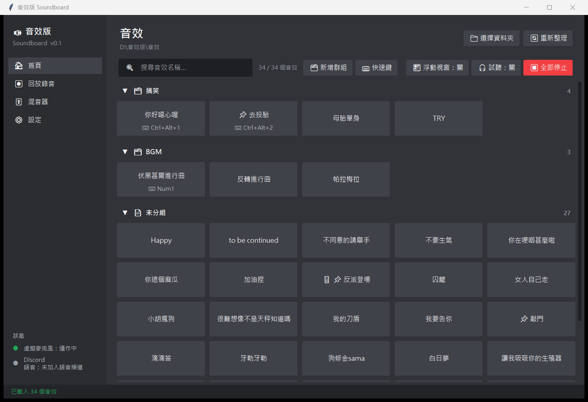

視窗分為下列區域：

| 區域 | 內容 |
|---|---|
| **左側導覽列** | 切換「🏠 首頁」「🖼 貼圖」「⏺ 回放錄音」「🎚 混音器」「⚙ 設定」五個頁面；設定有問題時「⚙ 設定」旁會顯示黃色 ⚠。上方顯示程式名稱與版本（`Soundboard v0.3`）。底部的**狀態**區隨時顯示「虛擬麥克風：運作中／未啟用」與「Discord 語音」狀態，試聽模式開啟時顯示「試聽模式：僅本機監聽」，回放錄音開啟時顯示「回放錄音：Discord」等來源（按一下狀態可切換至對應頁面） |
| **🏠 首頁** | 音效本身：搜尋框、依群組分區的音效按鈕，以及常用操作：📁 選擇資料夾、🔄 重新整理、🗂 新增群組、⌨ 快速鍵、🪟 浮動視窗、🎧 試聽、⏹ 全部停止 |
| **🖼 貼圖** | 貼圖縮圖牆（依系列分區）：按一下複製到剪貼簿；關鍵字搜尋、文字貼圖、用 Webhook 傳送貼圖或文字，說明見下方「🖼 貼圖」 |
| **⏺ 回放錄音** | 持續錄製多個來源（我的麥克風、Discord、YouTube 等）最近數分鐘的聲音，按一下「擷取」後分軌儲存為片段，可再選擇音軌、調整音量並修剪成新音效 |
| **🎚 混音器** | 所有音量集中於此：以推桿調整總音量、音效、麥克風與監聽，並可將 Chrome、Spotify 等程式的聲音傳送給通話對象 |
| **⚙ 設定** | 分為六張卡片：🎧 音訊裝置、🎙 麥克風與降噪、🚪 進場音效、🖥 開機與背景執行、🌐 語言、ℹ 關於（音量請至「🎚 混音器」調整） |
| **狀態列**（最下方） | 最近播放的音效、錯誤訊息與操作提示 |

視窗可自由縮放：寬度不足時，首頁工具列的按鈕會自動移至搜尋框下一列，音效按鈕的欄數也會隨之調整。
在高 DPI（125%、150% 等）螢幕上，按鈕與間距會等比例放大。

**通話對象聽不到音效時，首頁會明確提示**：尚未設定虛擬麥克風（或 Windows 預設播放裝置為虛擬音源線）時，
首頁上方會顯示黃色橫幅「尚未設定虛擬麥克風，通話對象無法聽到音效」，按一下「前往設定 →」即可切換至設定頁：

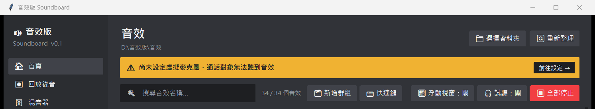

### 設定頁

按一下左側的「⚙ 設定」。所有變更皆會**立即生效並自動儲存**（介面語言除外，需重新啟動）：

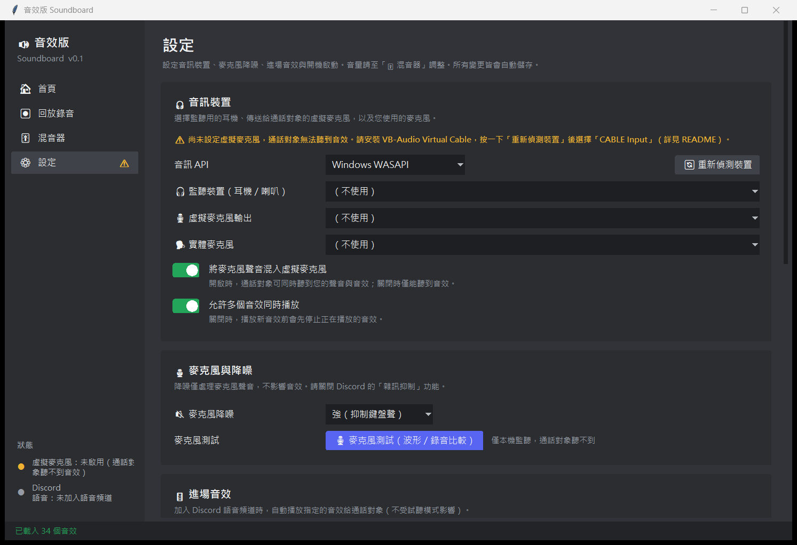

**🎧 音訊裝置**（卡片上方會顯示目前狀態：黃字表示有問題及處理方式，綠字表示虛擬麥克風運作中）

| 欄位 | 選擇方式 |
|---|---|
| **音訊 API** | 預設為 `Windows WASAPI`（延遲最低）。若某個裝置無法開啟，可改用 `Windows DirectSound` 或 `MME` |
| **🎧 監聽裝置（耳機／喇叭）** | 耳機、喇叭或「（系統預設）」；選擇「（不使用）」時僅通話對象聽得到。清單中**不會列出虛擬音源線**（選擇後將無法監聽）；若 Windows 預設播放裝置為 CABLE Input，「系統預設」會自動改用實體耳機 |
| **🎙 虛擬麥克風輸出** | `CABLE Input (VB-Audio Virtual Cable)`（安裝後通常會自動選取） |
| **🗣 實體麥克風** | 平常說話使用的麥克風 |
| 🔄 重新偵測裝置 | 插拔耳機或喇叭時程式會**自動**更新裝置清單；剛安裝 VB-CABLE 等驅動程式時可手動按一下 |
| 開關：將麥克風聲音混入虛擬麥克風 | 開啟時，通話對象可同時聽到說話聲與音效；關閉時僅能聽到音效 |
| 開關：允許多個音效同時播放 | 關閉時，播放新音效前會先停止正在播放的音效 |

> 在設定頁以滑鼠滾輪捲動時，經過下拉選單**不會**意外變更裝置（滾輪僅捲動頁面）。

### 音量

**所有音量皆於左側的「🎚 混音器」調整**（設定頁不提供音量滑桿，以免重複）：

| 通道 | 控制範圍 |
|---|---|
| 🎚 總音量 | 通話對象聽到的所有聲音 |
| 🔊 音效 | 送入虛擬麥克風的音效音量；**通話對象反映音效過大或過小時，請調整此通道** |
| 🎙 麥克風 | 說話聲的音量（通話對象聽到的） |
| 🎧 監聽 | 僅影響耳機中聽到的音效，不影響通話對象 |

- 範圍 0–200%；可拖曳推桿，或將滑鼠移至推桿上**使用滾輪**每次調整 5%，**按兩下**恢復 100%
- 超過 100% 時，程式會以**柔性限幅**壓制峰值，不會產生刺耳的爆音
- 單一音效過大或過小：在該音效上按右鍵，選擇「✂ 編輯／後製…」調整音量（見下方「編輯音效」）
- 音量會自動儲存；詳細說明見下方「🎚 混音器」

**🎙 麥克風與降噪**、**🚪 進場音效**、**🖥 開機與背景執行**、**🌐 語言**、**ℹ 關於**位於設定頁下方（向下捲動），說明見下方「🔇 麥克風降噪」「🎙 麥克風測試」「🚪 進場音效」「🖥 開機自動啟動與背景執行」「🌐 語言與 ℹ 關於」：

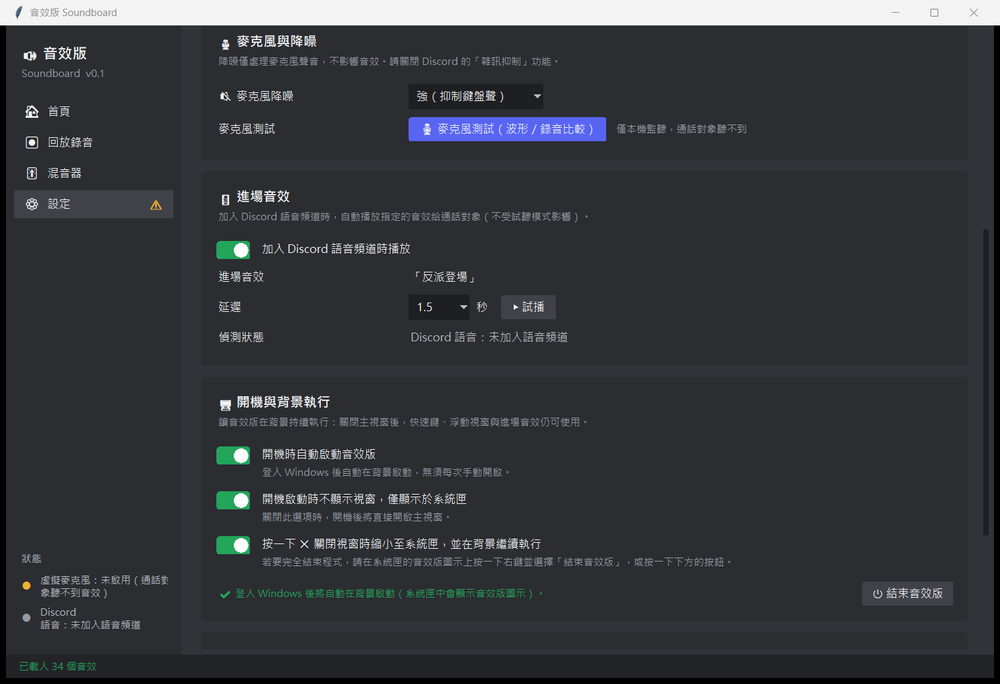

### Discord 設定

開啟 **Discord → 使用者設定 → 語音與視訊**：

- **輸入裝置**選擇 `CABLE Output (VB-Audio Virtual Cable)`
- 輸出裝置維持原本的耳機即可
- **關閉 Discord 的「雜訊抑制」（Krisp 與標準皆需關閉）**，否則音效會被當成雜訊濾除；
  鍵盤聲等雜音改由音效版的「🔇 麥克風降噪」處理（見下方），降噪僅處理麥克風聲音，不影響音效
- 「輸入模式」使用「語音啟動」時，請**關閉「自動判斷輸入靈敏度」**並手動調低靈敏度，否則音效與混音器的聲音可能被截斷；
  也可改用「按鍵發話」（按住按鍵時才會送出音效）

設定會自動儲存於 `%APPDATA%\Soundboard\settings.json`，下次開啟無須重新設定。

---

## 5. 使用方式

以下操作皆在 **🏠 首頁**進行：

| 操作 | 功能 |
|---|---|
| 左鍵按一下音效按鈕 | 傳送給通話對象並監聽（播放中的按鈕顯示為**藍色**） |
| **Shift＋左鍵** | 試聽：僅本機播放，通話對象聽不到（播放中的按鈕顯示為**綠色**） |
| 工具列「🎧 試聽：關」按鈕或 `Ctrl+P` | 開啟試聽模式後，**左鍵也僅在本機播放**，按鈕區會顯示綠框；再按一次即可關閉 |
| 右鍵 →「▶ 播放（通話對象＋監聽）」 | 同左鍵 |
| 右鍵 →「🎧 試聽（僅本機）」 | 同 Shift＋左鍵 |
| 右鍵 →「✏ 重新命名…（同時修改檔名）」 | **直接變更硬碟上的檔名**（副檔名不變），例如將 Discord 下載的數字檔名改為易於辨識的名稱；音量、快速鍵、浮動視窗與群組設定會自動沿用至新檔名 |
| 右鍵 →「✂ 編輯／後製…」 | 一邊試聽一邊調整音量（−80～+80 dB）、僅保留中間片段、淡入淡出，並儲存為新音效或另存檔案（見下方「編輯音效」） |
| 右鍵 →「📂 在檔案總管中顯示」 | 開啟音效檔所在位置 |
| 右鍵 →「🗑 刪除音效…」 | 確認後**連同硬碟上的檔案一併刪除**（檔案移至資源回收筒，可還原），見下方「刪除音效」 |
| 右鍵 →「⌨ 設定全域快速鍵…」 | 指定一組按鍵，**在遊戲中也能播放**（見下方「全域快速鍵」）；已設定時可選「⌨ 清除快速鍵」 |
| 右鍵 →「📌 加入浮動視窗」 | 將音效放到螢幕角落的半透明浮動視窗（見下方「浮動視窗」） |
| 右鍵 →「🚪 設為進場音效」 | 加入 Discord 語音頻道時自動播放（見下方「進場音效」） |
| 右鍵 →「🗂 移到群組」 | 將音效移入群組（見下方「音效分組」） |
| **Ctrl＋左鍵** | 複選音效（按鈕前顯示 ☑、外框變為藍色），再按右鍵選擇「🗂 移到群組」或直接拖曳，即可一次移動；按 `Delete` 一次刪除；按 `Esc` 取消選取 |
| `Esc` 或「⏹ 全部停止」 | 立即停止所有音效 |
| 🔍 搜尋 | 依名稱或檔名篩選按鈕 |
| 📁 選擇資料夾／🔄 重新整理 | 變更音效資料夾／新增檔案後重新讀取（含子資料夾）；目前的資料夾顯示於「音效」標題下方 |

> 單一音效的音量請使用「✂ 編輯／後製…」中的音量設定（右鍵選單已不再提供「⏹ 停止此音效」與「🔊 調整音量（±dB）…」；停止播放請使用 `Esc` 或「⏹ 全部停止」）。

### ✂ 編輯音效（音量 ±80 dB、修剪、另存）

下載的音效音量往往不一致。在音效上按右鍵，選擇「**✂ 編輯／後製…（修剪、音量、淡入淡出、另存）**」，會開啟與回放片段相同的編輯器：

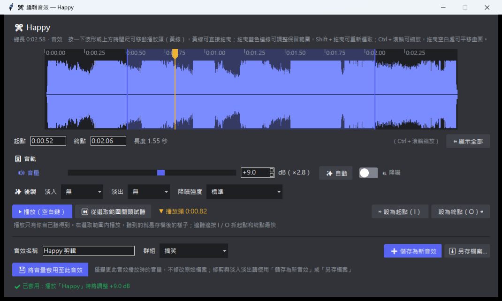

**音量**
- 使用滑桿或直接在欄位輸入 dB 值（例如 `-12`、`+6.5`），範圍 **−80～+80 dB**，0 為原始音量；
  ＋6 dB 約為兩倍音量，−6 dB 約為一半
- 「✨ 自動」會將音效調整至一般音效的響度（依選取範圍計算），便於統一各音效的音量
- 按一下「**💾 將音量套用至此音效**」：之後從首頁、浮動視窗、快速鍵或進場音效播放時，皆使用此音量。
  **原始檔案不會被修改**，可隨時改回 0 dB
- 放大後超過滿刻度的峰值會由峰值限制器平滑壓制，不會破音；編輯器中試聽到的聲音即為實際播放的聲音

**修剪與後製**（操作方式與回放片段的編輯器相同：按一下波形移動播放頭、拖曳藍色邊線調整範圍、按空白鍵播放、按 I／O 設定起點與終點、Ctrl＋滾輪縮放）
- 例如僅需保留中間一句：將藍色邊線拖曳至該段，或一邊試聽一邊按 I／O
- 淡入／淡出、🔇 降噪（適用於人聲）
- 「**➕ 儲存為新音效**」：將音量、修剪與後製結果寫入新檔案（`.ogg`），首頁會新增一個按鈕，預設放在原音效所屬的群組；
  原音效保持不變，不需要時可自行刪除
- 「**⬇ 另存檔案…**」：以 ogg／mp3／wav／flac 格式儲存至任意位置

### 試聽模式

需要先挑選音效、又不希望通話對象聽到時：

1. 按一下首頁工具列的「🎧 試聽：關」（或按 `Ctrl+P`），按鈕會變為綠色的「🎧 試聽：開（僅本機）」，側邊欄的狀態區也會顯示「試聽模式：僅本機監聽」
2. 此時按一下任何音效皆僅在本機播放，通話對象完全聽不到（不會送入虛擬麥克風）
3. 挑選完成後再按一次即可關閉試聽模式，左鍵恢復為傳送給通話對象

> 試聽模式不會被記憶，每次啟動程式時皆為關閉狀態，以免誤以為通話對象聽得到。
> 試聽需要在「⚙ 設定 → 🎧 監聽裝置（耳機／喇叭）」選擇耳機或喇叭；若設為「不使用」，狀態列會顯示提示。

| 按鈕顏色 | 意義 |
|---|---|
| 灰色 | 未播放 |
| 藍色外框＋☑ | 已以 Ctrl＋左鍵複選 |
| 🟦 藍色 | 播放中，通話對象聽得到 |
| 🟩 綠色 | 試聽中，僅本機監聽 |

### 重新命名（同時修改檔名）

在音效上按右鍵，選擇「✏ 重新命名…（同時修改檔名）」並輸入新名稱，**硬碟上的檔案會一併改名**（副檔名維持不變，例如 `.ogg`）。

- 原本設定於此音效的音量、快速鍵、浮動視窗與群組會沿用至新檔名，無須重新設定
- 名稱不可包含 `\ / : * ? " < > |`，結尾不可為空白或句點，也不可與同資料夾中的其他檔案重名；
  名稱不合法時會顯示說明，並保留已輸入的文字以便修改
- 檔案正由其他程式（例如播放器）使用時無法改名，請關閉該程式後再試

### 🗑 刪除音效（連同檔案）

不需要的音效可直接在音效版中刪除，無須另外至資料夾尋找檔案：

1. 在音效上按右鍵，選擇「🗑 刪除音效…（檔案將移至資源回收筒）」（或先以 **Ctrl＋左鍵**複選多個音效，再按右鍵選擇「🗑 刪除這 N 個音效…」，或直接按 `Delete` 鍵）
2. 確認視窗會列出要刪除的音效與檔案位置，按「是」才會刪除（預設按鈕為「否」）

- **硬碟上的檔案會一併刪除**，但會**移至資源回收筒**：誤刪時可至資源回收筒按「還原」，再回到音效版按「🔄 重新整理」即可恢復
  （快速鍵、群組等設定需重新設定）
- 此音效的快速鍵、群組、浮動視窗、音量與進場音效設定會一併移除；正在播放的音效會先停止，已開啟的編輯視窗會關閉
- 檔案位於沒有資源回收筒的位置（例如網路磁碟）時，會再次詢問是否要永久刪除（此操作無法復原）
- 群組右鍵選單的「🗑 刪除群組」僅刪除群組，**不會**刪除音效檔

### 音效分組

音效數量較多時，可分為「搞笑」「恐怖」「遊戲」等群組，首頁會依群組分區顯示：

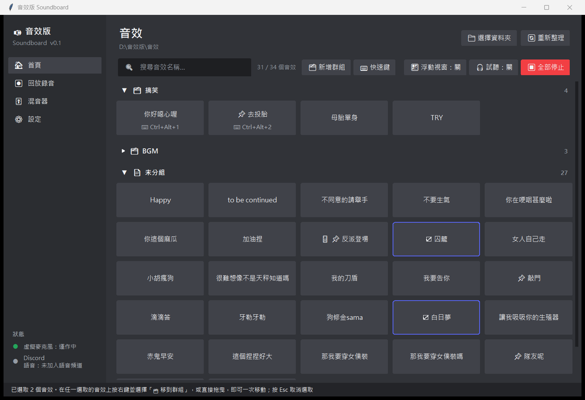

1. 按一下首頁工具列的「🗂 新增群組」，輸入群組名稱
2. **一次移動多個音效**：按住 `Ctrl` 並點選要移入的音效（按鈕前顯示 ☑），
   在任一選取的音效上按右鍵，選擇「🗂 移到群組（已選取 N 個）」並選擇群組
3. 僅移動一個音效：直接在該音效上按右鍵，選擇「🗂 移到群組」
4. **以滑鼠拖曳音效**：按住音效按鈕並拖曳至群組標題列（或群組中的任何位置）後放開，即可移入該群組；
   標題列變為藍色表示將放置於此。拖曳至某個音效上放開時，會**插入至該音效之前**，可用於調整群組內的順序。
   先以 `Ctrl` 複選再拖曳，可一次移動多個音效；拖曳至「未分組」即可移出群組
5. **以滑鼠拖曳群組標題調整群組順序**：按住群組標題列並上下拖曳，畫面上會以藍線標示插入位置，放開後群組即移至該處。
   「未分組」無法拖曳；搜尋時無法拖曳群組（部分群組被隱藏，插入位置無法對應）

| 在群組標題列上 | 功能 |
|---|---|
| 左鍵按一下 | 收合／展開（►／▼），狀態會被記憶 |
| 左鍵拖曳 | 調整群組順序（顯示藍色插入線） |
| 右鍵 →「✏ 重新命名群組…」 | 僅變更群組名稱，不影響音效檔 |
| 右鍵 →「⬆ 上移」／「⬇ 下移」 | 調整群組順序 |
| 右鍵 →「📌 將整個群組加入浮動視窗」 | 將群組內的所有音效一次加入浮動視窗 |
| 右鍵 →「🗑 刪除群組」 | 群組內的音效移回「未分組」，**檔案不會被刪除** |
| 右鍵 →「全部展開」／「全部收合」 | 一次展開或收合所有群組 |

- 一個音效同時只屬於一個群組；移入新群組時會自動離開原群組，選擇「↩ 移出群組（未分組）」可移回未分組
- 拖曳至捲動區上下邊緣時會自動捲動；按下後未移動即放開，仍視為一般的點擊（播放音效或收合群組）
- 搜尋時會自動展開符合條件的群組，並隱藏沒有符合項目的群組
- 群組僅為程式內的分類，**不會搬移檔案**；檔案暫時移走時，群組會保留其項目，檔案放回後即會再次顯示

### 全域快速鍵（遊戲中也能使用）

無須切出遊戲，按下快速鍵即可播放音效：

1. 在音效按鈕上按右鍵，選擇「⌨ 設定全域快速鍵…」
2. 直接按下想要的按鍵組合，例如 `Ctrl+Alt+1`、`Num1`（數字鍵盤）或 `F13`；按 `Esc` 取消
3. 設定完成後，按鈕下方會顯示 `⌨ Ctrl+Alt+1`，在遊戲中按下即可播放

首頁工具列的「⌨ 快速鍵」可集中檢視與修改所有快速鍵，並可設定下列**功能快速鍵**：

| 功能 | 說明 |
|---|---|
| ⏹ 全部停止 | 在遊戲中立即停止所有音效 |
| 🪟 顯示／隱藏浮動視窗 | 例如設為 `Ctrl+Alt+O`，需要時才顯示浮動視窗 |
| 🎧 切換試聽模式 | 開啟後，快速鍵播放的音效也僅在本機播放 |
| 🗂 浮動視窗切換至下一個群組 | 將浮動視窗切換至下一個群組（隱藏時會一併顯示） |
| ⏺ 擷取回放錄音 | 擷取回放錄音最近的聲音（見下方「回放錄音」） |

注意事項：

- 快速鍵會被音效版**攔截**，遊戲將收不到該按鍵，請避免使用遊戲的操作鍵；建議使用 Ctrl／Alt 組合鍵、數字鍵盤或 F13–F24
- 未搭配 Ctrl／Alt 的字母或數字鍵，設定後在任何地方都將無法輸入該字元，設定時程式會顯示警告
- 同一組按鍵只能指定給一個音效，指定給新音效時會自動從原音效移除
- 狀態列顯示快速鍵「已被其他程式使用」時，表示該組按鍵已被其他軟體（例如 Discord、顯示卡軟體）註冊，請改用其他組合
- 若遊戲以**系統管理員身分**執行，音效版也需以系統管理員身分執行，才能接收快速鍵

### 浮動視窗（螢幕角落的半透明音效版）

1. 在要加入的音效上按右鍵，選擇「📌 加入浮動視窗」（按鈕會顯示 📌）
2. 按一下首頁工具列的「🪟 浮動視窗：關」即可顯示（開啟時按鈕變為藍色的「🪟 浮動視窗：開」），預設位於螢幕右下角
3. 浮動視窗的操作（下圖為試聽模式開啟時的畫面）：

   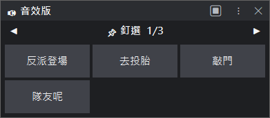


| 操作 | 功能 |
|---|---|
| 左鍵按一下音效 | 播放（試聽模式開啟時僅在本機播放） |
| Shift＋左鍵 | 試聽 |
| 拖曳標題列 | 移動位置（會被記憶） |
| `◀`／`▶`、在群組名稱上使用滾輪 | **切換群組**：📌 釘選的音效 → 群組 1 → 群組 2 → … |
| 按一下群組名稱 | 列出所有群組以直接選擇 |
| `⋮` 或在標題列上按右鍵 | 調整**不透明度**（30%–100%）、每列按鈕數、移到角落、顯示群組 |
| `⏹`／`✕` | 全部停止／隱藏浮動視窗 |

- 建立群組後，浮動視窗會新增一列 `◀ 群組名稱 ▶`，可在「📌 釘選的音效」與各群組之間切換：

  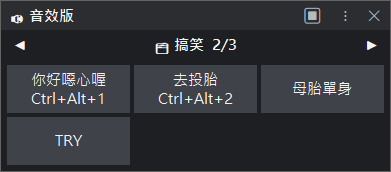

- 也可設定功能快速鍵「🗂 浮動視窗切換至下一個群組」，在遊戲中直接切換
- 浮動視窗永遠位於最上層，且**點選時不會搶走遊戲的焦點**，點選後可直接繼續操作遊戲
- 試聽模式開啟時，浮動視窗的標題列會變為綠色的「🎧 試聽中（僅本機）」
- 浮動視窗只能顯示在「**無邊框視窗**」或「視窗模式」的遊戲上方；**獨佔全螢幕**的遊戲會遮住浮動視窗（此時請使用全域快速鍵）

### 🚪 進場音效（加入 Discord 語音時自動播放）

與 Discord Nitro 的進場音效類似，加入語音頻道時會自動播放指定音效給通話對象：

1. 在音效上按右鍵，選擇「🚪 設為進場音效（進入 Discord 語音時播放）」（按鈕前顯示 🚪）
2. 開啟「⚙ 設定 → 🚪 進場音效」的「加入 Discord 語音頻道時播放」開關（設定進場音效時會自動開啟）
3. 加入任何語音頻道後，約 1.5 秒即會播放；可先按「▶ 試播」確認

- 同一張卡片的「偵測狀態」（以及側邊欄底部的狀態區）會顯示「Discord 語音：🟢 通話中／未加入語音頻道」
- 「延遲」為加入後等待播放的秒數：播放過早時 Discord 可能尚未完成連線，通話對象會聽不到開頭；若聽不到請調長
- 進場音效一律傳送給通話對象，不受試聽模式影響
- **僅在「加入」的當下播放**：啟動音效版時已在語音頻道中則不會播放；測試時請先離開語音頻道再重新加入

**偵測原理與限制**：Discord 僅在語音頻道中才會開啟錄音。音效版每秒透過 Windows 的音訊工作階段 API
查詢一次「哪些程式正在收音」（工作列的麥克風使用中圖示也是使用此資訊），偵測到 Discord 開始收音即表示已加入語音頻道。
此方式無須登入 Discord，也不違反 Discord 的使用條款。因此：

- 在 Discord 設定中按「麥克風測試」也會被視為加入語音頻道
- 直接切換語音頻道（例如從自己的頻道切換至其他頻道）也會播放；3 秒內的短暫斷線重連僅播放一次，避免網路不穩時重複播放

### 🖼 貼圖（按一下複製，到 Discord 按 Ctrl+V 傳送）

把喜歡的貼圖（例如用本專案附的「LINE 貼圖下載器」[`tools/line_sticker_dl`](tools/line_sticker_dl) 存下來的透明背景 PNG／GIF／APNG／WebP）放進貼圖資料夾，
在「🖼 貼圖」頁**按一下貼圖就會複製到剪貼簿**，再到 Discord 的輸入框按 `Ctrl+V` 即可以**自己的身分**傳送（頻道、私訊都可以）。
PNG 與 GIF 都以「檔案」放進剪貼簿，貼上後 GIF 仍會動；APNG、動態 WebP 會先自動轉成會動的 GIF。

**加入貼圖**

- 按「➕ 匯入貼圖」→「匯入圖片檔…」（可多選），或「匯入整個資料夾…」（保留子資料夾當作「系列」）
- 或直接按「📁 選擇資料夾」指向已有貼圖的資料夾，例如 LINE 貼圖下載器的輸出資料夾（一個系列一個資料夾，貼圖頁會依系列分區顯示）
- 預設的貼圖資料夾是音效資料夾旁邊的「貼圖」（也可以直接把檔案放進去，再按「🔄 重新整理」）
- 支援 `.png`（含 APNG）`.gif` `.webp`（含動態）`.jpg`
- 貼圖很多時（例如好幾千張）建議用「📁 選擇資料夾」直接指向原資料夾，不必「匯入」：匯入會把檔案複製一份（幾千張要花一兩分鐘，期間可以繼續使用程式），選擇資料夾則是瞬間完成、不佔額外空間。縮圖牆只會載入畫面附近的貼圖，幾千張也不會卡

**使用**

| 操作 | 說明 |
|---|---|
| 左鍵 | **複製到剪貼簿**，到 Discord 按 `Ctrl+V` 傳送；狀態列顯示「📋 已複製…」 |
| 滑鼠移到 ▶ 標記的貼圖上 | 播放動態貼圖的預覽 |
| 右鍵 | 📋 複製、✏ 輸入文字後複製（文字貼圖）、📤 用 Webhook 傳送、🏷 編輯關鍵字、📂 在檔案總管中顯示、🗑 刪除（移到資源回收筒） |
| 搜尋框 | 輸入文字後：① 符合**關鍵字**的貼圖排在最前面（💡 區）② **文字貼圖**直接套用你輸入的文字 ③ 名稱或系列符合的貼圖 |
| 貼圖大小 | 複製或傳送前把貼圖縮到長邊 320／240／160／120 像素（預設為原始大小，不會放大）；縮小後貼圖在聊天室裡比較像表情貼，檔案也較小 |

**🏷 關鍵字（打字跳出對應的貼圖）**

在貼圖上按右鍵 →「🏷 編輯關鍵字…」，輸入幾個字詞（以逗號或空白分隔，例如 `早安, 你好`）。之後在搜尋框打「早安」（或「大家早安」），
這張貼圖就會出現在最上方的「💡 關鍵字」區，按一下即可複製。關鍵字存在貼圖資料夾的 `keywords.json`，跟著貼圖資料夾走。
LINE 訊息貼圖的**預設文字**也會自動當作關鍵字。

> ℹ LINE App 裡「打字跳出貼圖」用的是每張貼圖的隱藏標籤，但這份資料只存在登入後的 LINE App 中（LINE 電腦版的本機資料庫也有加密），
> LINE Store 與公開的貼圖資料都沒有提供，所以無法直接匯入，需要自己為常用的貼圖加上關鍵字。

**✏ 文字貼圖（可自訂文字的貼圖）**

LINE 的**訊息貼圖**（每張可以自己打字）與**「隨你填」名字貼圖**會集中在貼圖頁最後、標題有 ✏ 的區塊。
在搜尋框輸入文字，這些貼圖就會**直接套用你打的字**，按一下即可複製套好字的貼圖；也可以右鍵 →「✏ 輸入文字後複製…」（輸入 `\n` 可換行）。

| 種類 | 文字怎麼畫上去 |
|---|---|
| 訊息貼圖 | 由 **LINE 伺服器**畫文字（和 LINE App 裡的字型、排版相同，需要網路）；沒有網路時改在本機畫字 |
| 名字貼圖 | LINE 畫名字的服務需要登入，所以在**本機**畫：比對貼圖上「****」的位置與顏色，以微軟正黑體畫上去；名字太長會自動縮小 |

文字貼圖需要 LINE 貼圖下載器另外存下的底圖與 `line_meta.json`。**舊版下載器抓的資料夾**，用新版下載器把同一個網址（例如作者頁）
再下載一次即可補上（已經存在的貼圖會略過，很快）。

**📨 用 Webhook 傳送（選用）**

不想切換到 Discord 時，也可以用 Discord 的 **Webhook** 直接傳到指定頻道：貼圖按右鍵 →「📤 用 Webhook 傳送到 Discord」，
或在貼圖頁上方的文字框輸入文字，按 `Enter`／「傳送文字」**傳送純文字訊息**。
Webhook 不需要建立機器人、不需要登入 Discord，也不會違反服務條款；代價是訊息會以「Webhook 的名稱」發送（可在設定視窗自訂「傳送者名稱」），
而不是你本人的帳號。傳送的文字不會觸發 `@everyone`、`@here` 或提及任何人。

1. 到 Discord 想要傳送的頻道（需要有「管理 Webhook」權限，自己的伺服器或私人頻道都可以）：⚙ 編輯頻道 → 整合 → Webhook → 新 Webhook → 複製 Webhook 網址
2. 在音效版按左側「🖼 貼圖」→「⚙ Webhook 設定…」，輸入名稱、貼上網址，按「儲存」
3. 按「傳送測試訊息」，頻道出現「✅ 音效版貼圖連線測試成功」就設定完成

可以儲存多個 Webhook（例如不同的伺服器），在貼圖頁「📨 Webhook 傳送到」的下拉選單切換傳送目標。

> 🔒 **Webhook 網址等同頻道的發言密碼**：它只存放在你自己電腦的 `%APPDATA%\Soundboard\settings.json`，不會寫進程式碼或儲存庫；畫面與紀錄檔也只顯示遮蔽後的網址。
> 請不要把設定檔或網址分享給別人；萬一外流，到 Discord 頻道的整合頁面刪除該 Webhook 即可作廢。

**Discord 的限制與處理方式**

| 項目 | 處理 |
|---|---|
| 檔案大小 | 一般伺服器單檔上限約 10 MB。靜態圖與 GIF 在限制內時**原檔照傳**；動態貼圖太大時會自動縮小尺寸、再抽掉部分影格，直到符合上限（仍然太大才會失敗並說明原因） |
| 動態貼圖 | Discord 只有 **GIF** 保證會動；APNG、動態 WebP 上傳通常只顯示第一格，所以一律**自動轉成 GIF**（保留透明、影格時間與循環） |
| 透明背景 | GIF 的透明只有「全透明／不透明」兩種，貼圖邊緣的半透明陰影會被截掉；靜態 PNG 則完整保留半透明 |
| 文字長度 | 一則文字訊息最多 2000 字，超過的部分不會送出 |
| 傳送太快 | Discord 會暫時限速；程式遇到時會等一下自動重試一次，仍失敗才顯示訊息 |

> 貼圖的著作權屬於原作者（例如 LINE 貼圖），請只做個人用途，不要散布或商用。

### 🎚 混音器（將 Chrome、Spotify 等程式的聲音傳送給通話對象）

左側導覽列的「🎚 混音器」：每個聲音各有一條通道，如同混音台般以推桿調整**通話對象聽到的**音量。

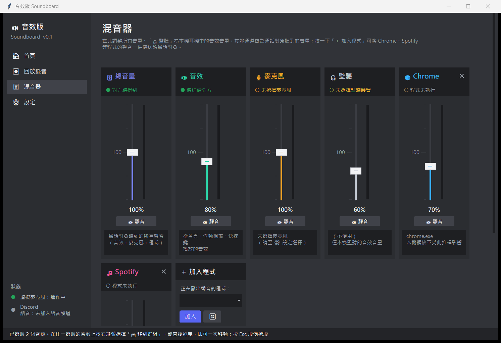

| 通道 | 控制的聲音 |
|---|---|
| 🎚 **總音量** | 通話對象聽到的所有聲音（音效＋麥克風＋程式）；靜音時通話對象聽不到任何聲音 |
| 🔊 **音效** | 從首頁、浮動視窗、快速鍵播放的音效（通話對象聽到的音量） |
| 🎙 **麥克風** | 說話聲（降噪後）；靜音等同關閉設定頁的「將麥克風聲音混入虛擬麥克風」 |
| 🎧 **監聽** | 本機耳機中的音效音量（不影響通話對象）；靜音時本機完全聽不到音效 |
| 🌐 **Chrome** 等程式 | 已加入的程式：其聲音會即時傳送給通話對象 |

**將程式的聲音傳送給通話對象**：

1. 先讓程式發出聲音（例如在 Chrome 播放 YouTube）
2. 在「＋ 加入程式」的下拉選單中選擇該程式（未顯示時按一下 🔄；也可直接輸入執行檔名稱，例如 `spotify.exe`），再按「加入」
3. 通道上方顯示「● 傳送給對方」即完成；程式關閉時顯示「○ 程式未執行」，下次開啟時會自動重新連接

- 推桿：拖曳或按一下設定（0–200%，超過 100% 會自動柔性限幅，不會爆音）；將滑鼠移至推桿上使用**滾輪**每格調整 5%；**按兩下**恢復 100%
- 推桿右側的**音量表**：綠色為正常、黃色為偏大、紅色為接近上限
- 「🔊 靜音」僅讓通話對象聽不到（按下後顯示「🔇 已靜音」），本機播放完全不受影響；按一下通道右上角的 ✕ 可移除該程式
- **本機仍會照常從喇叭或耳機聽到程式的聲音**：混音器僅另外複製一份送入虛擬麥克風，不會改變本機聽到的聲音
- 僅擷取已加入的程式（包含其子程序，因此 Chrome 的所有分頁皆會傳送），其他程式不受影響
- **無法加入 Discord**：通話對象的聲音會被傳回，造成回音
- 需要 Windows 10 2004 或以上版本（與回放錄音使用相同技術）；若要讓通話對象聽到，必須先設定「虛擬麥克風輸出」（頁面上方會顯示提示）
- 設定（已加入的程式、音量、靜音）會自動儲存，下次啟動時沿用

### 🖥 開機自動啟動與背景執行（系統匣常駐）

讓音效版持續在背景待命，玩遊戲前無須另外開啟：

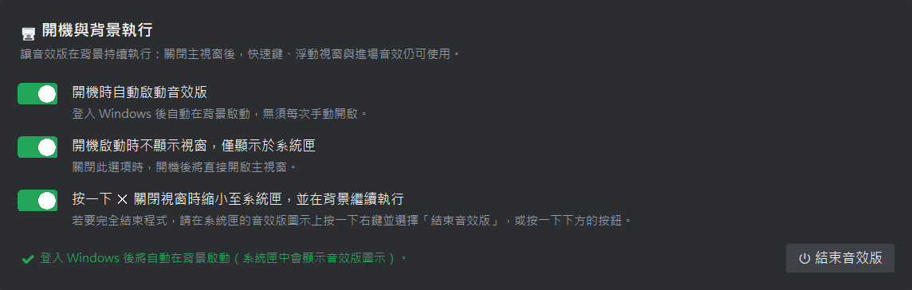

- **開機時自動啟動音效版**：登入 Windows 後自動在背景啟動（登記於目前使用者的開機項目，不需要系統管理員權限；
  在 Windows「工作管理員 → 啟動應用程式」中也會顯示「Soundboard」，可從該處停用）
- **開機啟動時不顯示視窗，僅顯示於系統匣**（預設開啟）：開機後僅在右下角系統匣顯示音效版圖示，不會開啟主視窗
- **按一下 ✕ 關閉視窗時縮小至系統匣，並在背景繼續執行**（預設開啟）：關閉主視窗後程式仍在背景執行，**快速鍵、浮動視窗、進場音效與回放錄音皆照常運作**；
  第一次按 ✕ 時會顯示通知
- 系統匣圖示：**按一下**開啟主視窗；**按右鍵**可選擇「顯示音效版」「浮動視窗」「試聽模式（僅本機監聽）」「全部停止」「結束音效版」（「浮動視窗」「試聽模式」打勾表示開啟中）
- **完全結束程式**：在系統匣圖示上按右鍵並選擇「結束音效版」，或按一下設定頁的「⏻ 結束音效版」
- 音效版已在背景執行時再次開啟 `Soundboard.exe`，不會啟動第二個執行個體，而是顯示原本的視窗
- 將 exe 移至其他資料夾後，開啟一次新位置的 exe 即會自動更新開機項目；
  若卡片下方提示「開機時將啟動另一個位置的音效版」，請關閉開關後再重新開啟，即可改為啟動目前的版本

### 🔇 麥克風降噪（取代 Discord 的雜訊抑制）

使用音效版時必須關閉 Discord 的雜訊抑制（否則音效會被濾除），但如此一來鍵盤聲與風扇聲也會被收錄。
音效版內建 **RNNoise** 開源 AI 降噪（OBS 內建的降噪即為此技術），**僅處理實體麥克風，音效完全不經過降噪**：

| 設定 | 效果 |
|---|---|
| 關閉 | 原音 |
| 標準（預設） | 去除持續性雜音（風扇、冷氣、電流聲）與大部分背景聲，人聲幾乎不受影響 |
| 強（抑制鍵盤聲） | 標準＋**人聲閘門**：AI 判斷未說話時**完全靜音**，鍵盤與滑鼠聲不會送出；說話時才開啟（預讀 10 ms 保留字頭，說完後保持 0.25 秒保留字尾） |

- 降噪強度於「⚙ 設定 → 🎙 麥克風與降噪」選擇；選擇「強」時，下拉選單右側會即時顯示「🎙 傳送中」或「🔇 靜音（未偵測到人聲）」：僅打字而未說話時應顯示「靜音」
- **一邊說話一邊打字時**，鍵盤聲會隨人聲一併送出（此時閘門為開啟狀態），Krisp 也難以完全處理此情況
- 降噪會增加約 30 ms 延遲（「強」約 40 ms），CPU 使用量很低（單一核心約 5%）
- 降噪僅保留人聲，因此請勿以麥克風播放音樂給通話對象（會被視為雜音而壓制），音樂請以音效版播放

### 🎙 麥克風測試（波形圖、錄音前後比較）

按一下「⚙ 設定 → 🎙 麥克風與降噪」的「🎙 麥克風測試（波形／錄音比較）」開啟，以視覺與聽覺確認鍵盤聲是否已被濾除：

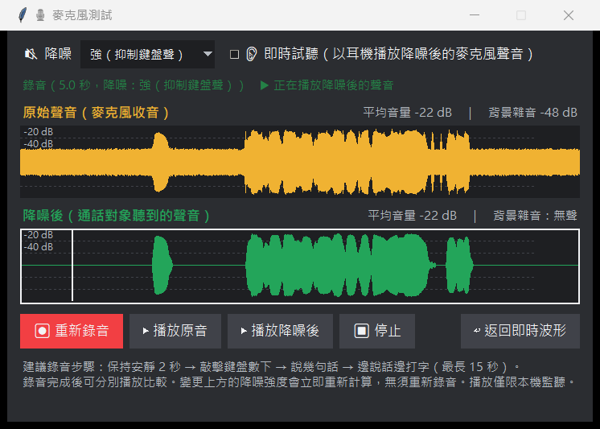

- **兩條波形**：黃色為麥克風收到的**原始聲音**，綠色為**降噪後**（通話對象聽到的聲音）。採用 dB 刻度，小聲的雜音也能看見
- 右上角的「**背景雜音**」為未說話時的音量：原音約為 −50 dB，降噪有效時會變得很低或顯示「無聲」
- **錄音比較**：按「⏺ 開始錄音」，依序保持安靜 2 秒、敲擊鍵盤數下、說幾句話、一邊說話一邊打字，再按「⏹ 停止錄音」（最長 15 秒），
  之後以「▶ 播放原音」「▶ 播放降噪後」交替比較；播放時波形上會顯示播放位置
- 錄音完成後**變更上方的降噪強度會立即重新計算**，無須重新錄音即可比較「標準」與「強」
- 「👂 即時試聽」可從耳機即時聽到降噪後的麥克風聲音（約 30 ms 延遲）；關閉測試視窗時會自動關閉
- 錄音與播放**僅在本機進行，僅本機監聽**，不會送入虛擬麥克風，也不會存檔

### ⏺ 回放錄音（錄下通話對象剛才說的話，剪輯成新音效）

通話對象剛說了一句值得保留的話時，按一下「擷取」即可保存**最近數分鐘**的聲音，再剪出所需的數秒製作成新的音效按鈕。

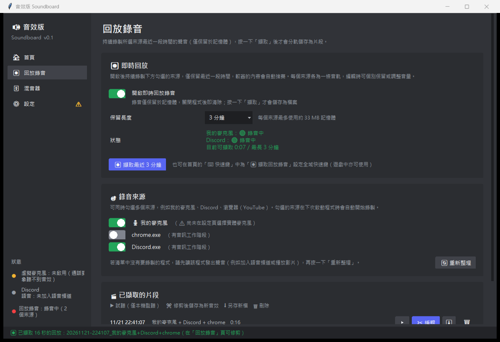

1. 開啟「⏺ 回放錄音」頁，開啟「**開啟即時回放錄音**」
2. 在「🎯 錄音來源」勾選要錄製的來源，**可同時勾選多個**：
   - **🎙 我的麥克風**：設定頁所選的實體麥克風，錄製的是**降噪後、通話對象聽到的聲音**
   - **Discord.exe**：語音頻道中通話對象的聲音
   - **chrome.exe／msedge.exe**（YouTube 等）、遊戲、音樂播放器等任何會發出聲音的程式

   僅錄製已勾選的來源，未勾選的程式完全不會被錄製。程式未出現在清單中時，請先讓該程式發出聲音，再按一下「🔄 重新整理」
3. 在「保留長度」選擇保留時間（30 秒～10 分鐘，預設 3 分鐘）。超過的部分會自動捨棄，**僅保留於記憶體中，不會寫入硬碟**
4. 需要保存時，按一下「**⏺ 擷取最近 3 分鐘**」（或在「⌨ 快速鍵」中設定「⏺ 擷取回放錄音」，在遊戲中也能使用）。
   **每個來源會分別儲存為一條音軌**，並顯示於「🎬 已擷取的片段」
5. 片段可按 ▶ 試聽（僅本機監聽，已自動調整音量）、⬇ 另存為 ogg／mp3／wav／flac、🗑 刪除，或按「✂ 編輯」進行後製：

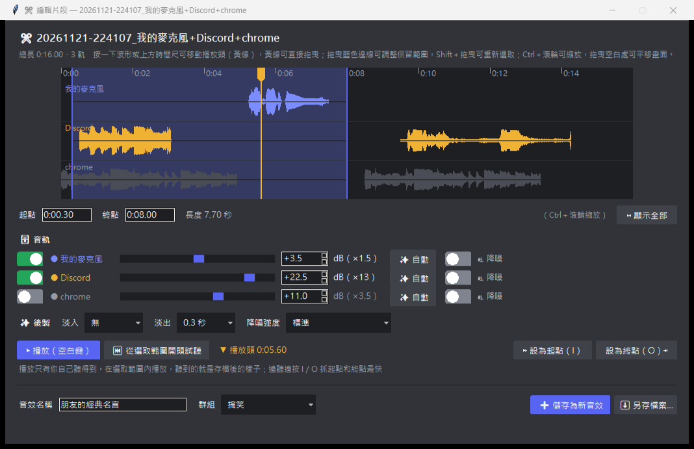

**播放頭與選取範圍**（與剪輯軟體相同）
- 每個來源各有一條波形，可看出誰在何時說話

| 滑鼠 | 作用 |
|---|---|
| **按一下**波形或上方時間尺 | 將**播放頭**（黃線）移至該處，選取範圍不變；播放中按一下會直接跳至該處繼續播放 |
| **拖曳黃線**（黃線左右數 px 內，或時間尺上的黃色把手） | 移動播放頭；**播放中也可拖曳**，放開後從新位置繼續播放 |
| **拖曳藍色邊線** | 調整要保留的範圍（開頭／結尾）；也可直接在「起點／終點」輸入時間（例如 `12.5` 或 `1:05.2`） |
| **Shift＋拖曳** | 重新選取一段範圍 |
| **Ctrl＋滾輪** | 以滑鼠位置為中心放大／縮小（最小可顯示 0.2 秒），便於精準設定開頭與結尾；按「↔ 顯示全部」恢復顯示整段 |
| 放大後**拖曳空白處**／滾輪 | 左右平移畫面；播放時播放頭移出畫面會自動翻頁 |

| 操作 | 作用 |
|---|---|
| **空白鍵**／「▶ 播放（空白鍵）」 | 從播放頭開始播放；再按一次暫停，播放頭停在暫停位置 |
| 「⏮ 從選取範圍開頭試聽」 | 從選取範圍的開頭播放成品 |
| **I**／「⇤ 設為起點（I）」 | 將選取起點設為播放頭位置（一邊試聽一邊按，最快設定剪輯點） |
| **O**／「設為終點（O）⇥」 | 將選取終點設為播放頭位置 |
| **Home** | 播放頭移至最前面 |

- 播放頭位於**選取範圍內**時，播放的是成品（含降噪、淡入淡出），並於選取終點停止；
  位於範圍外時，播放各音軌依目前音量混音的聲音，直到片段結尾

**🎚 音軌（各音軌分別調整）**
- **開關**：僅保留需要的來源。例如只需要通話對象的那句話、不需要 YouTube 的背景音樂時，關閉 chrome 音軌即可
- **🔊 音量**（−24～+30 dB）：回放錄製的是程式「調整音量前」的聲音，通常比平常聽到的**小 20 dB 以上**，
  因此開啟編輯器時**各音軌皆已自動放大**至一般音效的音量；也可拖曳滑桿手動調整，或按「✨ 自動」依目前選取範圍重新計算
- 波形會依音量即時縮放。混音後的峰值由**峰值限制器**平滑壓制於滿刻度以下：僅在峰值前後數十毫秒略微降低音量，
  不會破音，因此可放心放大；超過約 **15 倍**（比滿刻度高約 21.6 dB）時波形才會變為**紅色**，並顯示「⚠ 音量過大，部分片段將被大幅壓縮」，
  實際效果請以試聽結果為準
- **🔇 降噪**：以 RNNoise 去除該音軌的鍵盤聲與風扇聲（適用於人聲，不適用於音樂）。僅處理選取範圍，於背景計算；
  「降噪強度」可選擇「標準」或「強（無語音時靜音）」

**✨ 後製**
- **淡入／淡出**：無～2 秒（即使選擇「無」，頭尾也會自動加入 5 ms，從聲音中間剪下時不會產生爆音）

**試聽與儲存**
- 試聽僅在本機播放；播放中變更音量或音軌開關時，會從目前位置以新設定繼續播放
- 填寫「音效名稱」並選擇「群組」後，按一下「**➕ 儲存為新音效**」：會以 `.ogg` 格式存入音效資料夾，首頁會立即新增按鈕
- 「⬇ 另存檔案…」可將成品儲存至任意位置

**效能**（實測）：每錄製一個程式約使用 **0.3% 的單一 CPU 核心**（整顆 CPU 的 0.02%）；記憶體每分鐘約 11 MB，
保留 3 分鐘約 33 MB、10 分鐘約 110 MB（每個來源各一份）。擷取 3 分鐘並存檔不到 1 秒，且於背景進行，不會造成畫面停頓。

**說明**

- 程式的聲音為送往喇叭「之前」的數位訊號，不受喇叭音量影響；Discord 的聲音僅包含通話對象，自己的聲音請勾選「🎙 我的麥克風」
- 「我的麥克風」錄製的是「⚙ 設定 → 🗣 實體麥克風」所選的裝置；即使未開啟「將麥克風聲音混入虛擬麥克風」，錄音時也會自動開啟該麥克風
- 片段儲存於設定檔旁的「回放片段」資料夾（`%APPDATA%\Soundboard\回放片段`，每個片段一個資料夾、每條音軌一個 FLAC 檔），
  按一下「📂 開啟片段資料夾」即可開啟
- 需要 **Windows 10 2004（19041）或以上版本**；Discord 或瀏覽器重新開啟後會自動重新連接
- 預設為關閉。錄製他人聲音前，請先取得對方同意

### 🌐 語言與 ℹ 關於

**🌐 語言**：「介面語言」可選擇「跟隨系統」、繁體中文、English、日本語、한국어。
- 「跟隨系統」依 Windows 的顯示語言決定（括號內顯示實際採用的語言）；中文環境使用繁體中文，不支援的語言使用英文
- 變更後會詢問「需重新啟動音效版才能套用新的介面語言。是否立即重新啟動？」：選擇「是」立即重新啟動，選擇「否」則於下次啟動時套用
- 尚未翻譯的文字會以繁體中文原文顯示

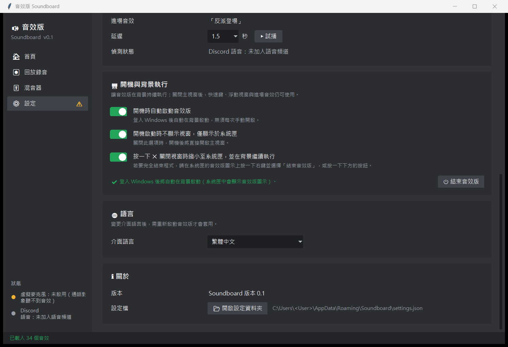

各語言的介面（English／日本語／한국어）：

| English | 日本語 | 한국어 |
|---|---|---|
| 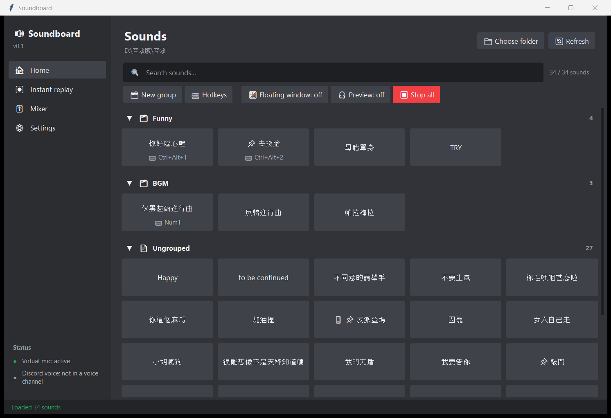 | 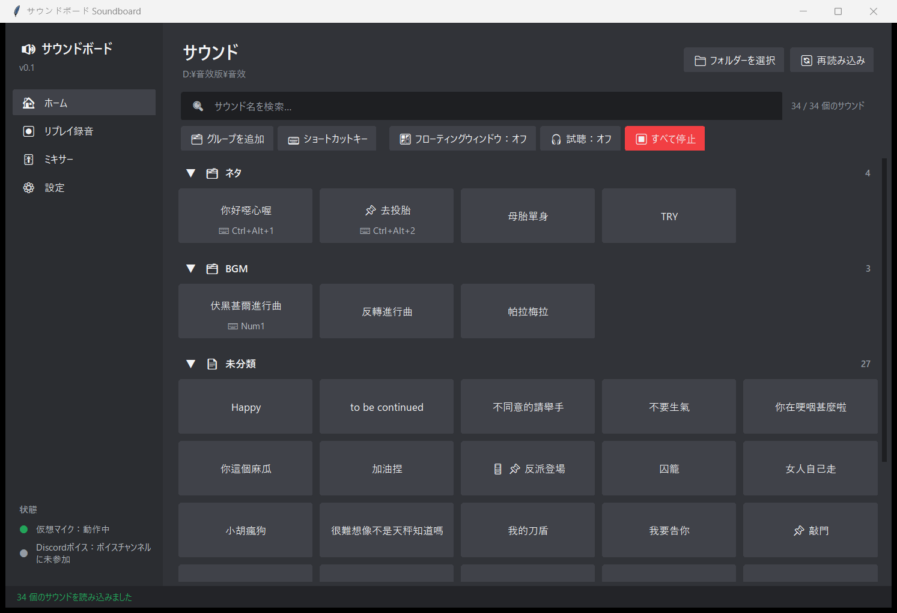 | 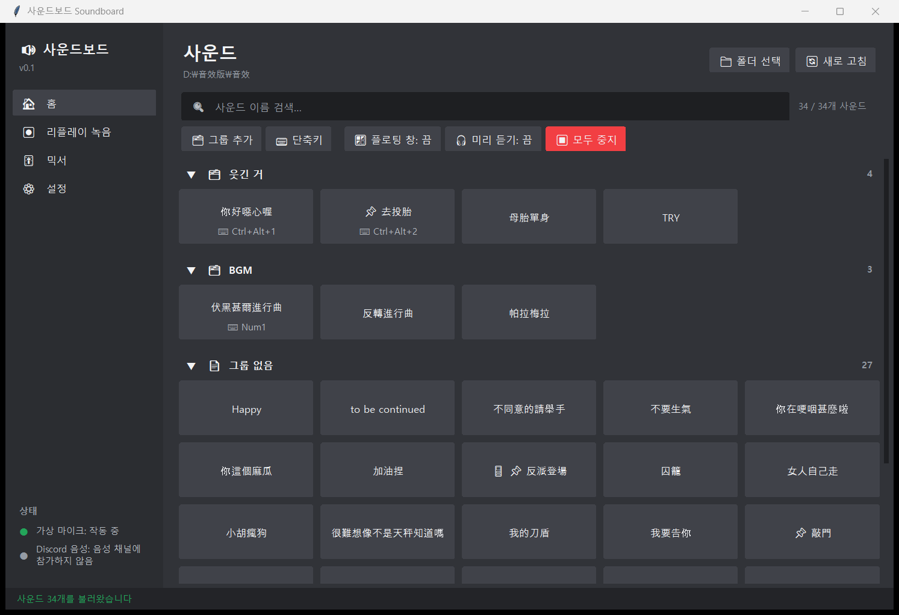 |

**ℹ 關於**：顯示版本（例如「Soundboard 版本 0.2」）與設定檔位置；按一下「📂 開啟設定資料夾」可開啟設定檔、紀錄檔與回放片段所在的資料夾。

### 範例：在 Discord 播放「驚嘆音效」

1. 將 `wow.mp3` 放入音效資料夾，按一下「🔄 重新整理」
2. 以 **Shift＋左鍵**試聽該按鈕以確認音量；音量過大時，按右鍵選擇「✂ 編輯／後製…」，將音量設為 `-6` dB 並按「💾 將音量套用至此音效」
3. 在 Discord 語音頻道中以左鍵按一下該按鈕，本機與通話對象會同時聽到
4. 按右鍵選擇「⌨ 設定全域快速鍵…」並按下 `Ctrl+Alt+W`，之後在遊戲中按下此組合鍵即可播放
5. 按右鍵選擇「📌 加入浮動視窗」，再開啟「🪟 浮動視窗」，即可在螢幕角落直接點選

---

## 6. 常見問題

**貼圖傳不出去／文字貼圖**
- 「Webhook 無效或已被刪除」：Discord 頻道裡的 Webhook 被刪掉了，重新建立後到「⚙ Webhook 設定…」更新網址
- 「無法連線到 Discord」：檢查網路、Proxy 或防火牆，確認電腦連得上 discord.com
- 「檔案太大」：伺服器的上傳上限比預設小，把「傳送大小」改成較小的值
- 動態貼圖在 Discord 不會動：確認傳出去的是 GIF（程式會自動轉換）；按一下複製的動態貼圖也是轉換後的 GIF
- 「「****」沒有換成我打的字」或文字貼圖不在 ✏ 區：該系列是舊版下載器抓的，請用新版 LINE 貼圖下載器把同一個網址再下載一次
- 訊息貼圖的字型和 LINE 不一樣：沒有網路或 LINE 暫時拒絕時會改在本機畫字；恢復連線後重新輸入即可
- 縮圖一直顯示「…」或「⚠」：該檔案不是有效的圖片，或未安裝 Pillow（`pip install pillow`）

**通話對象聽不到音效**
- 首頁上方顯示黃色橫幅「尚未設定虛擬麥克風」：按一下「前往設定 →」，安裝 VB-CABLE 後按「🔄 重新偵測裝置」並選擇 `CABLE Input`
- Discord 的輸入裝置未選擇 `CABLE Output`
- Discord 的雜訊抑制濾除了音效：請關閉 Discord 的雜訊抑制，改用音效版的「🔇 麥克風降噪」
- Discord 的輸入靈敏度過高：請調低，或改用按鍵發話

**混音器加入的程式，通話對象聽不到**
- 通道狀態為「○ 程式未執行」：程式需正在執行；Chrome 等程式重新開啟後約 2 秒內會自動重新連接
- 確認「🎚 總音量」或該通道未靜音，且推桿未拉至 0
- 頁面上方顯示黃色提示「尚未設定虛擬麥克風」：請至設定頁選擇 CABLE Input

**通話對象反映說話聲或音效消失**
- 請檢查「🎚 混音器」：「總音量」靜音時通話對象聽不到任何聲音；「音效」靜音時通話對象聽不到音效

**按 ✕ 之後快速鍵仍有反應，或音效版似乎無法關閉**
- 此為背景執行：按 ✕ 只會縮小至右下角系統匣。若要完全結束，請在系統匣圖示上按右鍵並選擇「結束音效版」
- 若不需要此行為：在「⚙ 設定 → 🖥 開機與背景執行」關閉「按一下 ✕ 關閉視窗時縮小至系統匣，並在背景繼續執行」
- 系統匣中找不到圖示：按一下工作列右下角的「^」以展開隱藏的圖示

**開機後未自動啟動**
- 請參閱「⚙ 設定 → 🖥 開機與背景執行」卡片下方的說明：若已在「工作管理員 → 啟動應用程式」中停用，會顯示警告；開啟開關即可重新啟用

**本機聽不到音效（通話對象聽得到）**
- 「🎧 監聽裝置（耳機／喇叭）」不可選擇 CABLE Input，請選擇耳機（目前版本已不會列出虛擬音源線，舊設定會自動修正）
- 安裝 VB-CABLE 後，Windows 常將 **CABLE Input 設為預設播放裝置**。程式會自動避開，但建議至
  「設定 → 系統 → 音效 → 輸出」將預設裝置改回耳機，否則遊戲、YouTube 等聲音也會流入麥克風而被通話對象聽到
- 確認「🎚 混音器」的「🎧 監聽」未拉至 0% 或靜音

**在遊戲中按快速鍵沒有反應**
- 狀態列顯示「已被其他程式使用」時，請改用其他按鍵組合
- 遊戲以系統管理員身分執行時，音效版也需「以系統管理員身分執行」
- 確認音效版仍在執行中（快速鍵僅在程式執行時有效）

**看不到浮動視窗**
- 遊戲為「獨佔全螢幕」時會遮住浮動視窗，請將遊戲改為「無邊框視窗」
- 浮動視窗位於畫面外：在首頁按兩次「🪟 浮動視窗」，會自動移回螢幕範圍內

**通話對象聽不到說話聲**
- 確認「⚙ 設定 → 🎧 音訊裝置」的「將麥克風聲音混入虛擬麥克風」已開啟，且「🗣 實體麥克風」選擇正確
- 調高「🎚 混音器」的「🎙 麥克風」推桿

**找不到喇叭或耳機（例如剛開啟的 USB 或藍牙喇叭）**
- 程式每 2 秒檢查一次裝置插拔，接上後數秒內即會自動出現在「🎧 監聽裝置（耳機／喇叭）」清單中，狀態列會顯示「偵測到音訊裝置變動，已自動更新裝置清單」
- 若仍未出現，請按「⚙ 設定 → 🔄 重新偵測裝置」；若仍然沒有，請先確認 Windows「設定 → 系統 → 音效」中可看到該裝置
- 先前選擇的裝置暫時未連接時會改用系統預設，**重新連接後會自動選回**

**進場音效未播放**
- 檢查「⚙ 設定 → 🚪 進場音效」的偵測狀態（或側邊欄底部的狀態區）：在語音頻道中應顯示「通話中」
- 啟動音效版時已在語音頻道中則不會播放（僅在「加入」時播放）：請離開語音頻道後重新加入
- 顯示「無法偵測」：Windows 的音訊服務異常，請重新開機後再試
- 有播放但通話對象只聽到後半段：請將「延遲」調長（例如 2–3 秒）

**已開啟降噪，通話對象仍聽得到鍵盤聲**
- 改用「強（抑制鍵盤聲）」，並以「🎙 麥克風測試」錄製一段，確認打字時綠色波形為平坦狀態
- 僅打字時若設定頁的指示持續顯示「🎙 傳送中」，表示 AI 將鍵盤聲判斷為人聲：請將麥克風移遠，或調低麥克風靈敏度
- 確認 Discord 的「輸入裝置」為 `CABLE Output`；若直接選擇實體麥克風，聲音不會經過音效版的降噪
- Discord 的「自動增益控制」會放大殘餘的微小雜音，可考慮關閉

**已開啟降噪，通話對象反映說話聲斷斷續續**
- 改用「標準」（「強」會壓低判斷為非人聲的片段，小聲說話時可能被誤判）

**某個裝置無法開啟（狀態列顯示紅字）**
- 該裝置可能正被其他程式以「獨占模式」使用，或已被拔除；請改用其他音訊 API（DirectSound／MME）

**聽到自己的聲音有回音**
- 請勿在 Windows「聆聽此裝置」中監聽 CABLE Output

**音效檔未出現在清單中**
- 確認副檔名在支援格式表中；m4a／aac／wma 等格式需要 ffmpeg（狀態列會顯示提示）
- 部分 .ogg 檔（某些錄音或剪輯工具的輸出，時間戳記有誤差）會自動修正後播放，不需要安裝 ffmpeg

**回放錄音錄不到聲音，或顯示「等待中」**
- 確認要錄製的程式正在執行且已勾選；Discord 需在語音頻道中、且通話對象有說話才會有聲音
- 「我的麥克風：⏸ 等待中」並顯示「未收到聲音，請確認設定頁的實體麥克風」：請至「⚙ 設定」確認「🗣 實體麥克風」選擇正確，且未被其他程式獨占

**回放錄到的聲音很小**
- 此為正常現象：錄製的是程式「調整音量前」的聲音。編輯器開啟時各音軌會自動放大，也可拖曳「🔊 音量」滑桿進一步放大
- 顯示「⚠ 無法錄音」：Windows 版本過舊（需要 10 2004 或以上），或該程式以系統管理員身分執行而音效版不是

**介面語言沒有改變**
- 變更「🌐 語言」後需重新啟動音效版才會套用；若當時選擇「否」，請完全結束音效版（系統匣圖示右鍵 →「結束音效版」）後再重新開啟

---

## 7. 打包成 exe 分享

其他使用者**無須安裝 Python**，只需取得一個 `.exe`：

```powershell
pip install -e ".[build]"
```

```powershell
python packaging/build_exe.py
```

產出：

| 檔案 | 說明 |
|---|---|
| `release/音效版.zip` | **分享時請傳送此檔案**（約 25 MB） |
| `release/音效版/Soundboard.exe` | 單一執行檔（已包含英、日、韓翻譯檔） |
| `release/音效版/音效/` | 空資料夾，將音效檔放入此處，程式會自動讀取 |
| `release/音效版/使用說明.txt` | 給使用者的安裝步驟（VB-CABLE、Discord 設定、操作方式） |

注意事項：

- 使用者仍需**自行安裝 VB-CABLE**：它是需要系統管理員權限的驅動程式，無法包含於 exe 中
- exe 內建支援 `.ogg .mp3 .wav .flac .opus .aiff` 等格式；`.m4a .wma` 等格式需另外安裝 ffmpeg
  （完整的 ffmpeg 約 220 MB，因此不包含在內）
- exe 沒有數位簽章，第一次執行時 Windows 可能顯示「Windows 已保護您的電腦」，請按「其他資訊 → 仍要執行」
- exe 版的錯誤紀錄寫入 `%APPDATA%\Soundboard\soundboard.log`
  （每次啟動時重寫；**程式異常結束後重新開啟**時，上一次的紀錄位於同資料夾的 `soundboard.prev.log`，異常結束當下的狀況也會記錄於其中）
- 修改程式碼後重新執行 `python packaging/build_exe.py` 即可產生新版本
- 版本號定義於 `src/soundboard/__init__.py` 的 `__version__`（目前為 `"0.3.0"`，畫面上顯示為 `0.3`）

---

## 8. 多語言（開發者說明）

介面支援繁體中文、English、日本語、한국어，設計如下：

- **原始碼中的介面文字一律以繁體中文撰寫，並以 `tr("…")` 包住**；繁體中文原文本身即為翻譯的 key，閱讀程式碼時可直接看到畫面上的文字
- 含變數的文字使用具名佔位符，不使用字串串接（各語言語序不同）：

  ```python
  from soundboard.i18n import tr
  self.set_status(tr("已載入 {count} 個音效", count=n))
  ```

- **模組層級的常數**在匯入時尚未決定語言，請以 `N_("…")` 標記，顯示時再以 `tr()` 翻譯：

  ```python
  from soundboard.i18n import N_, tr
  ACTIONS = {"stop": N_("⏹ 全部停止")}
  label = tr(ACTIONS["stop"])
  ```

- 其他語言的翻譯檔位於 `src/soundboard/locales/<語言代碼>.json`（`en`、`ja`、`ko`），格式為 `{"繁體中文原文": "翻譯"}`；
  值為空字串表示尚未翻譯，程式會顯示繁體中文原文
- 語言於啟動時決定一次，切換語言需重新啟動程式；紀錄檔（logging）與命令列輸出維持中文，方便除錯

新增或修改介面文字後，請以下列指令整理翻譯檔（於專案根目錄執行）：

```powershell
python packaging/i18n_sync.py              # 新增缺少的 key（值為空字串）、移除已不使用的 key，並列出統計
```

```powershell
python packaging/i18n_sync.py --missing ja # 以 JSON 輸出指定語言尚未翻譯的原文（提供給翻譯者）
```

```powershell
python packaging/i18n_sync.py --check      # 僅檢查：有缺漏或佔位符不一致時回傳非 0（CI／測試用）
```

`tests/test_i18n.py` 會檢查每種語言的每段介面文字皆已翻譯、佔位符與原文一致，以及沒有在模組載入時呼叫 `tr()`。
因此新增或修改介面文字後，請執行 `i18n_sync.py` 並補齊 `en`、`ja`、`ko` 的翻譯，否則測試會失敗。

---

## 9. 專案結構

```
Soundboard/
├─ README.md                # 說明文件（English）
├─ README.zh-TW.md           # 說明文件（繁體中文）
├─ pyproject.toml            # 專案與相依套件
├─ 啟動音效版.bat             # 按兩下啟動
├─ packaging/
│  ├─ build_exe.py           # 一鍵打包成 exe 與分享用 zip
│  ├─ launcher.py            # PyInstaller 進入點
│  ├─ i18n_sync.py           # 同步翻譯檔的 key、列出未翻譯文字、檢查佔位符
│  └─ 使用說明.txt            # 隨 exe 附上的使用說明
├─ src/soundboard/
│  ├─ __init__.py            # 套件與版本號（__version__）
│  ├─ __main__.py            # 進入點、命令列參數、單一執行個體（再次開啟時顯示原本的視窗）
│  ├─ version.py             # 版本資訊（程式名稱、顯示用版本號）
│  ├─ i18n.py                # 介面多語言：tr()／N_()、偵測系統語言、載入翻譯檔
│  ├─ locales/               # 翻譯檔（en.json、ja.json、ko.json）
│  ├─ autostart.py           # 開機自動啟動（目前使用者的登錄檔 Run 機碼）
│  ├─ tray.py                # 系統匣圖示與單一執行個體（Win32 API，ctypes）
│  ├─ config.py              # 常數（取樣率、支援格式等）與設定檔讀寫
│  ├─ models.py              # 資料模型：AudioDevice／SoundItem／AppSettings
│  ├─ decoder.py             # 解碼（libsndfile，ffmpeg 備援）、轉立體聲、重新取樣
│  ├─ ogg_repair.py          # 修正時間戳記有誤差的 Ogg 檔（於記憶體中修正，不修改原檔）
│  ├─ mixer.py               # 即時混音：Voice／MixBus／RingBuffer／LiveSource（程式聲音的抖動緩衝）
│  ├─ engine.py              # 音訊引擎：監聽、虛擬麥克風、實體麥克風三條串流（麥克風經降噪）
│  ├─ devices.py             # 裝置列舉、虛擬音源線自動偵測
│  ├─ hotkeys.py             # 全域快速鍵（Win32 RegisterHotKey，專屬執行緒）
│  ├─ overlay.py             # 螢幕角落的半透明置頂浮動視窗（點選時不搶焦點）
│  ├─ dialogs.py             # 按鍵擷取、快速鍵設定對話框
│  ├─ grouping.py            # 音效分組：依群組切分首頁的區塊
│  ├─ denoise.py             # 麥克風降噪（RNNoise，以 ctypes 呼叫 _vendor/rnnoise.dll）
│  ├─ discord_voice.py       # 偵測加入 Discord 語音（Windows 音訊工作階段 API，背景執行緒）
│  ├─ process_capture.py     # 僅錄製特定程式的聲音（WASAPI 程式音訊迴送，以 ctypes 直接呼叫 COM）
│  ├─ app_audio.py           # 混音器：將指定程式的聲音即時送入虛擬麥克風（程式重新開啟時自動連接）
│  ├─ replay.py              # 回放錄音：多來源（程式、我的麥克風）環形緩衝、依時間對齊分軌擷取
│  ├─ clips.py               # 回放片段：多音軌存取、自動音量、混音、降噪、修剪、淡入淡出、匯出
│  ├─ stickers.py            # 貼圖：掃描資料夾、為 Discord 準備檔案（動態轉 GIF、縮小到大小上限）、縮圖
│  ├─ sticker_meta.py        # 貼圖附加資訊：讀 line_meta.json（文字貼圖、預設文字）、自訂關鍵字（keywords.json）
│  ├─ sticker_text.py        # 文字貼圖：請 LINE 伺服器畫訊息貼圖的字，或在本機畫名字貼圖的字
│  ├─ discord_webhook.py     # 用 Discord Webhook 上傳檔案（標準庫實作、限速重試、遮蔽網址）
│  ├─ clipboard.py           # 把檔案放進 Windows 剪貼簿（CF_HDROP）
│  ├─ mictest.py             # 麥克風測試視窗：即時波形、錄音前後比較
│  ├─ _vendor/               # rnnoise.dll 與授權檔（來源見 _vendor/README.txt）
│  ├─ theme.py               # 介面配色
│  ├─ library.py             # 掃描資料夾、LRU 音訊快取、背景預載
│  └─ gui/                   # Tkinter 介面
│     ├─ app.py              # 主視窗外框（側邊欄、內容區、狀態列）、播放、浮動視窗、系統匣選單、背景訊息
│     ├─ home.py             # 🏠 首頁：音效按鈕、群組區塊、搜尋、拖曳（音效與群組順序）、複選
│     ├─ stickers_page.py    # 🖼 貼圖頁：縮圖牆、關鍵字搜尋、文字貼圖區、匯入、右鍵選單、Webhook 傳送文字
│     ├─ sticker_actions.py  # 貼圖的複製／傳送、文字貼圖套字、Webhook 傳送文字（背景執行緒）
│     ├─ webhook_dialog.py   # Discord Webhook 設定視窗
│     ├─ replay_page.py      # ⏺ 回放錄音頁：選擇錄音來源、保留長度、擷取、片段清單
│     ├─ clip_editor.py      # ✂ 片段／音效編輯器：多音軌波形、播放頭、各音軌音量（音效 ±80 dB）／降噪、修剪、淡入淡出、儲存為新音效
│     ├─ mixer_page.py       # 🎚 混音器頁：所有音量（總音量、音效、麥克風、監聽、程式）、加入／移除程式、音量表
│     ├─ channel_strip.py    # 混音器通道：垂直推桿、音量表、靜音按鈕
│     ├─ page_kit.py         # 卡片式頁面的共用骨架（設定頁與回放錄音頁共用）
│     ├─ settings_page.py    # ⚙ 設定頁：裝置選擇與自動偵測、降噪、進場音效、開機與背景執行、語言、關於
│     ├─ menus.py            # 音效／群組的右鍵選單
│     ├─ editing.py          # 分組、釘選、進場音效、改名（變更檔名）、刪除（移至資源回收筒）、單一音效音量
│     ├─ hotkey_controller.py# 全域快速鍵的設定、註冊與觸發
│     ├─ widgets.py          # 自訂元件：圓角按鈕、圓角卡片、開關、捲動區
│     ├─ styles.py           # 字型、DPI 縮放、ttk 深色樣式
│     └─ presenters.py       # 將狀態轉換為畫面文字的純函式（可單元測試）
└─ tests/                    # 單元測試（混音、解碼、Ogg 修正、快速鍵、分組、改名、降噪、語音偵測、麥克風測試、回放錄音、開機啟動與系統匣、混音器、刪除音效、介面顯示邏輯、多語言）
   ├─ test_i18n.py           # 多語言：語言比對、翻譯回退、翻譯檔完整且佔位符一致、載入時不呼叫 tr()、版本顯示
   └─ …                      # 其他測試
```

執行測試：

```powershell
pip install -e ".[dev]"
```

```powershell
python -m pytest
```
